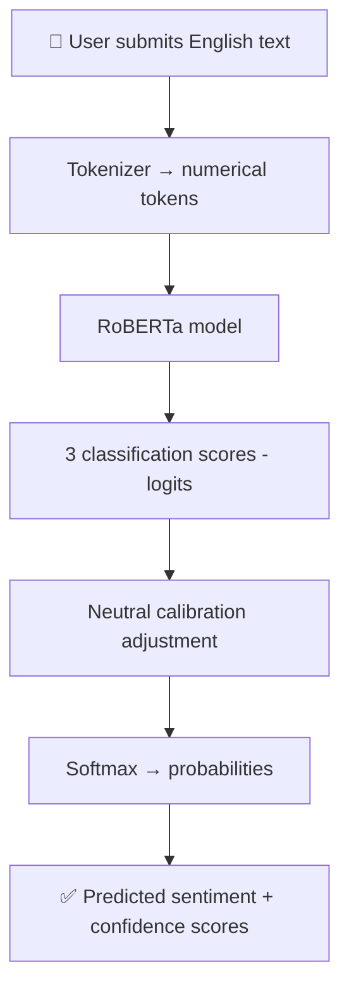
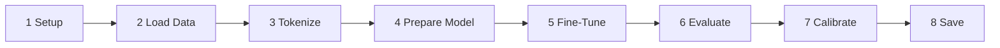
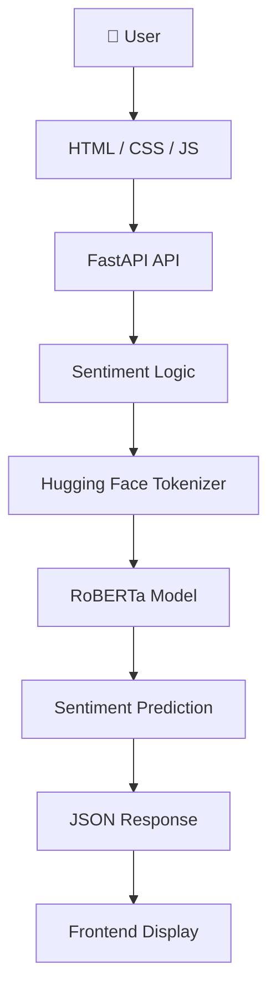

<div align="center">

# 🧠 SmartFeel AI

### Intelligent Sentiment & Customer Experience Platform

*An AI-powered sentiment analysis platform built with Python, PyTorch, Hugging Face Transformers, FastAPI, HTML, CSS, and JavaScript.*


**Positive 😊 · Neutral 😐 · Negative 😞**

</div>

---

SmartFeel AI uses a fine-tuned **RoBERTa Transformer model** to analyze English text and classify its sentiment into three categories: **Positive**, **Neutral**, and **Negative**.

The platform helps users understand opinions, customer feedback, product reviews, and social media comments through Natural Language Processing (NLP).

## 📑 Table of Contents

1. [Project Overview](#1--project-overview)
2. [Technologies and Libraries](#2--technologies-and-libraries)
3. [Artificial Intelligence Model](#3--artificial-intelligence-model)
4. [Dataset](#4--dataset)
5. [Model Training – Google Colab](#5--model-training--google-colab)
6. [Model Performance](#6--model-performance)
7. [Model Files](#7--model-files)
8. [Application Architecture](#8--application-architecture)
9. [Project Structure](#9--project-structure)
10. [Installation and Running](#10--installation-and-running)
11. [Data Storage and History](#11--data-storage-and-history)
12. [Testing](#12--testing)
13. [Limitations](#13--limitations)
14. [Future Improvements](#14--future-improvements)
15. [References](#15--references)
16. [Project Information](#16--project-information)

---

## 1. 🎯 Project Overview

SmartFeel AI combines a deep learning model with a web-based application to provide an interactive sentiment analysis experience. Users can submit text, analyze customer reviews, process multiple social media comments, view sentiment statistics, and review their previous analyses.

### ✨ Main Features

| Feature | Description |
|---|---|
| 🎮 **AI Playground** | Analyze any English text and receive a sentiment prediction. |
| 📊 **Dashboard** | View sentiment statistics, model performance, and analysis activity. |
| 🛍️ **ReviewAI** | Analyze product reviews and understand customer opinions. |
| 💬 **SocialMind** | Analyze multiple social media comments and calculate their sentiment distribution. |
| 🕘 **History** | View and manage previous sentiment analyses. |

### 🎓 Project Objectives

- Apply deep learning techniques to a real-world NLP problem.
- Fine-tune a pretrained Transformer model for sentiment classification.
- Build a web application that allows users to interact with the model.
- Understand how AI predictions can support customer experience analysis.
- Connect a Python backend with a modern web frontend.

---

## 2. 🧰 Technologies and Libraries

The project combines machine learning, backend development, frontend development, and data management.

### 🤖 Artificial Intelligence and Machine Learning

| Technology | Purpose |
|---|---|
| **Python** | Main programming language |
| **PyTorch** | Deep learning framework |
| **Hugging Face Transformers** | Loading, training, and using the RoBERTa model |
| **Hugging Face Tokenizers** | Converting text into model inputs |
| **Scikit-learn** | Model evaluation and performance metrics |
| **Pandas** | Data processing and analysis |
| **NumPy** | Numerical operations |
| **Safetensors** | Saving and loading model weights |

### ⚙️ Backend

| Technology | Purpose |
|---|---|
| **FastAPI** | Creating the Python backend and REST API |
| **Uvicorn** | Running the FastAPI application |
| **JSON** | Storing application history and sample data |

### 🖥️ Frontend

| Technology | Purpose |
|---|---|
| **HTML5** | Webpage structure |
| **CSS3** | Styling and responsive design |
| **JavaScript** | Frontend interactions and API communication |
| **Chart.js** | Displaying charts and sentiment statistics |

### 🛠️ Development and Version Control

`Visual Studio Code` · `Git` · `GitHub` · `Google Colab`

---

## 3. 🤖 Artificial Intelligence Model

The core of SmartFeel AI is a fine-tuned **RoBERTa Transformer model**.

### Base Model

> `cardiffnlp/twitter-roberta-base`

This pretrained model is based on the RoBERTa architecture and is suitable for processing social media text. Instead of training a Transformer from scratch, the project uses **transfer learning**: the pretrained model is fine-tuned on a sentiment classification dataset.

### 💡 Why RoBERTa?

RoBERTa is a Transformer-based language model that understands text using contextual information. It considers how words relate to each other instead of analyzing each word independently.

| Input | Sentiment |
|---|---|
| "I love this product!" | 😊 Positive |
| "The product is okay." | 😐 Neutral |
| "I hate this product!" | 😞 Negative |

### Model Architecture



### Prediction Classes

| Label | Meaning |
|:---:|---|
| `0` | 😞 Negative |
| `1` | 😐 Neutral |
| `2` | 😊 Positive |

The application displays the prediction with its confidence percentage and the scores for all three classes.

---

## 4. 📚 Dataset

The model was fine-tuned using the **TweetEval Sentiment Dataset** from Cardiff NLP.

- 🔗 **Dataset:** [cardiffnlp/tweet_eval](https://huggingface.co/datasets/cardiffnlp/tweet_eval)
- ⚙️ **Configuration:** `sentiment`

The dataset contains English tweets labeled as negative, neutral, or positive.

### Dataset Distribution

| Dataset Split | Number of Samples |
|---|---:|
| Training | 45,615 |
| Validation | 2,000 |
| Testing | 12,284 |
| **Total** | **59,899** |

### Dataset Labels

| Label | Sentiment |
|:---:|---|
| `0` | Negative |
| `1` | Neutral |
| `2` | Positive |

### How the splits are used

| Split | Purpose |
|---|---|
| **Training set** | Used to fine-tune the model. |
| **Validation set** | Used to evaluate the model during development and select the calibration adjustment. |
| **Testing set** | Used for final performance evaluation. |

---

## 5. 📓 Model Training – Google Colab

Training was performed in Google Colab using a GPU environment. The training notebook is **`SmartFeel_AI_Training.ipynb`**, which contains the main steps used to prepare, fine-tune, evaluate, and save the model.



### Training Process

**Step 1 – Environment Setup**
The required Python libraries were installed, including PyTorch, Transformers, Datasets, and Scikit-learn.

**Step 2 – Dataset Loading**
The TweetEval sentiment dataset was downloaded from Hugging Face and divided into training, validation, and testing sets.

**Step 3 – Tokenization**
The RoBERTa tokenizer converted text into numerical input tokens. The maximum sequence length was set to 128 tokens, with dynamic padding used during training.

**Step 4 – Model Preparation**
The pretrained `cardiffnlp/twitter-roberta-base` model was loaded for three-class sequence classification.

**Step 5 – Fine-Tuning**
The model was fine-tuned on the training dataset for two epochs.

| Parameter | Value |
|---|---|
| Model | RoBERTa |
| Batch size | 16 |
| Maximum sequence length | 128 |
| Training epochs | 2 |
| GPU environment | NVIDIA Tesla T4 |

**Step 6 – Evaluation**
The model was evaluated using accuracy, precision, recall, and F1-score.

**Step 7 – Calibration**
A neutral logit adjustment was tested using the validation set. The selected neutral bias was:

> **`+0.55`**

This adjustment was applied to the neutral class score before calculating the final probabilities.

**Step 8 – Saving the Model**
The final calibrated model was saved and downloaded for local use in the SmartFeel AI application.

---

## 6. 📈 Model Performance

The final calibrated model achieved the following results on the test dataset.

| Metric | Final Result |
|---|---:|
| **Accuracy** | **73.05%** |
| **Macro F1-score** | **0.7280** |

<details>
<summary><b>📋 Class performance (click to expand)</b></summary>

<br>

| Sentiment | Precision | Recall | F1-score |
|---|---:|---:|---:|
| 😞 Negative | 0.72 | 0.77 | 0.74 |
| 😐 Neutral | 0.73 | 0.73 | 0.73 |
| 😊 Positive | 0.75 | 0.68 | 0.71 |

</details>

### Baseline Comparison

A TF-IDF and Logistic Regression baseline was also evaluated.

| Model | Test Accuracy |
|---|---:|
| TF-IDF + Logistic Regression | 59.40% |
| 🏆 **Final Calibrated RoBERTa** | **73.05%** |

The fine-tuned RoBERTa model achieved a higher test accuracy than the traditional machine learning baseline.

### Calibration Results

The neutral calibration adjustment improved overall test accuracy compared with the uncalibrated second-epoch model.

> ✅ The final calibration was selected using **validation data**, not by repeatedly tuning against the test dataset.

---

## 7. 📦 Model Files

The trained model is stored locally in:

```text
models/smartfeel_roberta_calibrated_final/
```

| File | Description |
|---|---|
| `model.safetensors` | Contains the trained neural network weights. |
| `config.json` | Contains the model architecture configuration. |
| `calibration_config.json` | Contains the neutral calibration adjustment. |
| `tokenizer.json` | Contains tokenizer information. |
| `tokenizer_config.json` | Contains tokenizer configuration. |

> ⚠️ The model weights are large files and should not normally be committed directly to GitHub.
> See [`models/download_instructions.md`](models/download_instructions.md) for instructions on obtaining the model files.

---

## 8. 🏗️ Application Architecture

SmartFeel AI uses a separated frontend and backend architecture.

### 🖥️ Frontend

Built using HTML, CSS, and JavaScript. It is responsible for:

- Displaying the application interface.
- Receiving user text.
- Sending requests to the backend.
- Displaying sentiment predictions.
- Updating charts and statistics.
- Showing previous analyses.

### ⚙️ Backend

Developed using Python and FastAPI. It is responsible for:

- Receiving API requests.
- Loading and managing the sentiment model.
- Processing text input.
- Running sentiment predictions.
- Saving and retrieving history.
- Returning JSON responses to the frontend.

> 💡 The model should be loaded **once** when the application starts, rather than being loaded again for every prediction.

### General Application Workflow



<details>
<summary>Plain-text version of the diagram</summary>

```text
             USER
               |
               v
        HTML / CSS / JS
               |
               v
          FASTAPI API
               |
               v
        SENTIMENT LOGIC
               |
               v
       HUGGING FACE TOKENIZER
               |
               v
        RoBERTa MODEL
               |
               v
      SENTIMENT PREDICTION
               |
               v
         JSON RESPONSE
               |
               v
        FRONTEND DISPLAY
```

</details>

---

## 9. 📁 Project Structure

The project is organized into separate folders to make the code easier to understand and maintain.

```text
abo068/
│
├── backend/
│   ├── main.py
│   ├── __init__.py
│   │
│   └── src/
│       ├── __init__.py
│       ├── sentiment.py
│       ├── history.py
│       └── utils.py
│
├── frontend/
│   ├── index.html
│   │
│   └── assets/
│       ├── css/
│       └── js/
│
├── models/
│   ├── download_instructions.md
│   └── smartfeel_roberta_calibrated_final/
│       ├── config.json
│       ├── calibration_config.json
│       ├── tokenizer.json
│       ├── tokenizer_config.json
│       └── model.safetensors
│
├── data/
│   ├── history.json
│   └── demo_reviews_seeded.json
│
├── training/
│   └── training_notes.md
│
├── tests/
│   └── test_history.py
│
├── train.py
├── requirements.txt
├── README.md
└── .gitignore
```

> 📝 This structure describes the intended organization of the project. If the actual folder names or files differ, update this section to match the repository.

---

## 10. 🚀 Installation and Running

### Requirements

- Python 3.11 or a compatible Python version
- Git
- The SmartFeel AI model files
- Required Python libraries

### Step 1 · Clone the Repository

```bash
git clone https://github.com/xahiru/PT22026.git
cd PT22026/abo068
```

### Step 2 · Create a Virtual Environment

```bash
python -m venv venv
```

Activate it on Windows:

```powershell
.\venv\Scripts\Activate.ps1
```

### Step 3 · Install Dependencies

```bash
python -m pip install -r requirements.txt
```

### Step 4 · Download the Model

Follow the instructions in [`models/download_instructions.md`](models/download_instructions.md) and make sure the model files are placed in the correct directory.

### Step 5 · Start the Application

For a FastAPI application with the entry point `backend/main.py` and an application object named `app`, run:

```bash
python -m uvicorn backend.main:app --reload
```

Then open 👉 **http://127.0.0.1:8000**

> If your actual FastAPI entry point or object name is different, adjust the command accordingly.

---

## 11. 🗄️ Data Storage and History

SmartFeel AI uses JSON files for simple local data storage.

### `history.json`

Stores previous analyses. A history record can contain:

- Analysis source
- Original text
- Predicted sentiment
- Confidence percentage
- Scores for the three sentiment classes
- Analysis date and time

**Example:**

```json
{
    "source": "AI Playground",
    "text": "I really love this product!",
    "sentiment": "Positive",
    "confidence": 95.5,
    "scores": {
        "Negative": 1.2,
        "Neutral": 3.3,
        "Positive": 95.5
    },
    "time": "2026-11-18 14:30:00"
}
```

### `demo_reviews_seeded.json`

Contains sample customer reviews that can be used to demonstrate the application and test the ReviewAI functionality.

> JSON storage is suitable for a small educational project, but a production application with multiple users would benefit from a proper database.

---

## 12. 🧪 Testing

The project includes a testing folder, `tests/`, for example `tests/test_history.py`.

The purpose of history tests is to verify that the application can correctly **save**, **retrieve**, and **clear** analysis records. Testing helps identify errors before they affect the application.

If the project uses pytest, tests can be executed with:

```bash
python -m pytest
```

---

## 13. ⚠️ Limitations

Although SmartFeel AI provides useful sentiment predictions, it has some limitations.

| # | Area | Description |
|:-:|---|---|
| 1 | 🌍 **English Language** | The current model is designed for English text and is not a multilingual sentiment model. |
| 2 | 🎭 **Sarcasm** | Sarcastic sentences can be difficult to classify correctly. |
| 3 | 🧩 **Context** | The model may not understand the full context behind some sentences. |
| 4 | 🐦 **Domain Differences** | Fine-tuned on Twitter-style text, so customer reviews and professional feedback may behave differently. |
| 5 | 📉 **Prediction Confidence** | Confidence percentages represent the model's output probabilities and should not be interpreted as guaranteed correctness. |
| 6 | 🗄️ **Data Storage** | JSON storage is simple but is not designed for large-scale multi-user applications. |
| 7 | 🌐 **Internet Data** | SocialMind analyzes comments submitted by the user. It does not automatically collect comments from the entire internet or social media platforms. |

---

## 14. 🔮 Future Improvements

- [ ] Support for additional languages
- [ ] Fine-tuning on customer review datasets
- [ ] Improved detection of sarcasm and complex emotions
- [ ] Adding user accounts and authentication
- [ ] Replacing JSON storage with SQLite or PostgreSQL
- [ ] Adding more detailed analytics
- [ ] Improving model accuracy through additional experiments
- [ ] Deploying the application online

---

## 15. 📖 References

1. Liu, Y. et al. (2019). *RoBERTa: A Robustly Optimized BERT Pretraining Approach.* <https://arxiv.org/abs/1907.11692>
2. Cardiff NLP. *TweetEval Dataset.* <https://huggingface.co/datasets/cardiffnlp/tweet_eval>
3. Cardiff NLP. *Twitter RoBERTa Base Model.* <https://huggingface.co/cardiffnlp/twitter-roberta-base>
4. Hugging Face. *Transformers Documentation.* <https://huggingface.co/docs/transformers>
5. PyTorch. *Official Documentation.* <https://pytorch.org/docs/>
6. FastAPI. *Official Documentation.* <https://fastapi.tiangolo.com/>
7. Scikit-learn. *Official Documentation.* <https://scikit-learn.org/stable/>

---

## 16. 🗒️ Project Information

| | |
|---|---|
| **Project Name** | SmartFeel AI – Intelligent Sentiment & Customer Experience Platform |
| **Student Folder** | `abo068` |
| **Main Language** | Python |
| **AI Model** | Fine-tuned RoBERTa |
| **Dataset** | CardiffNLP TweetEval Sentiment |
| **Backend** | FastAPI |
| **Frontend** | HTML, CSS, JavaScript |
| **Deep Learning Framework** | PyTorch |
| **Model Library** | Hugging Face Transformers |
| **Project Type** | Machine Learning / Natural Language Processing / Web Application |

<div align="center">

---

*SmartFeel AI is an educational machine learning project demonstrating how Transformer-based NLP models can be integrated into a web application to analyze sentiment and support customer experience understanding.*

</div>
