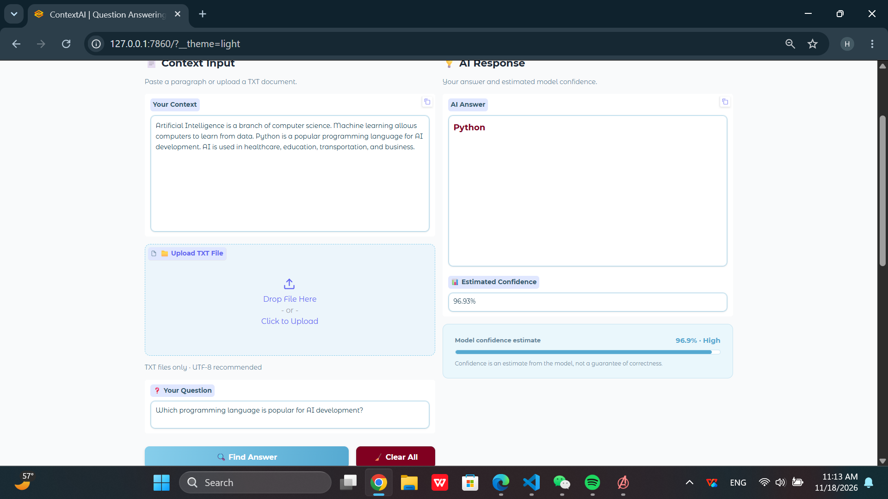
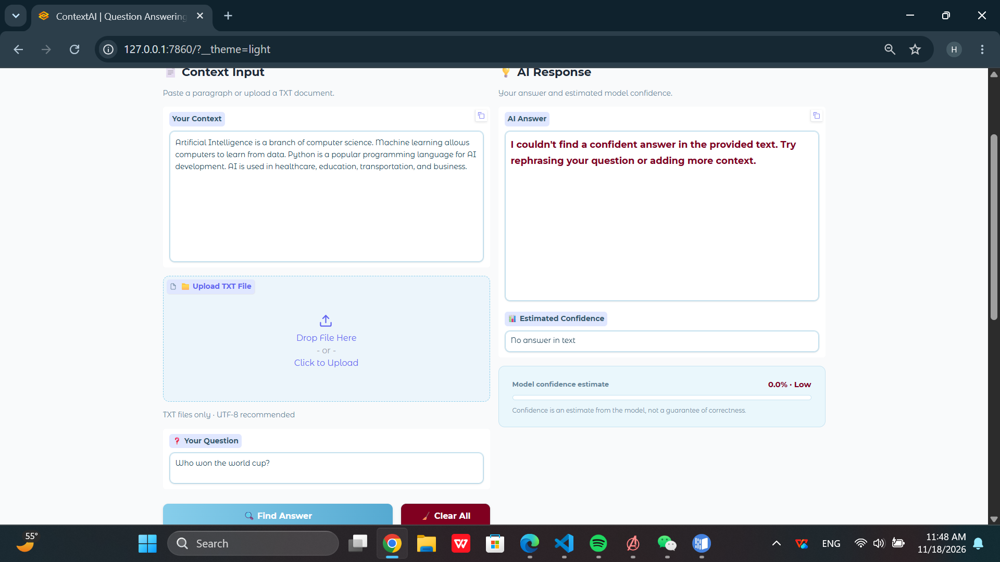
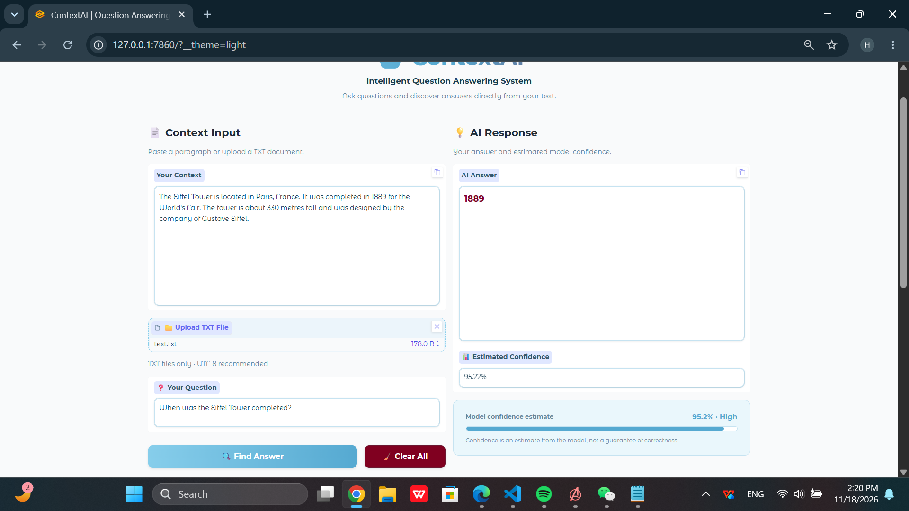
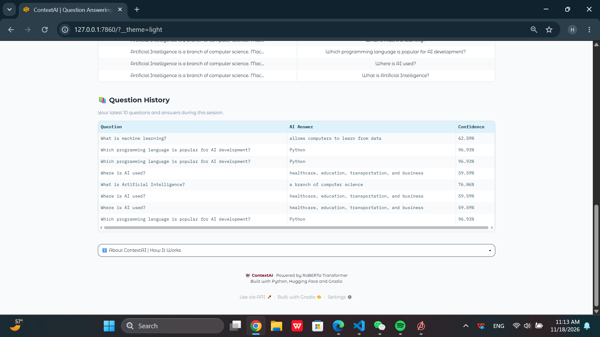
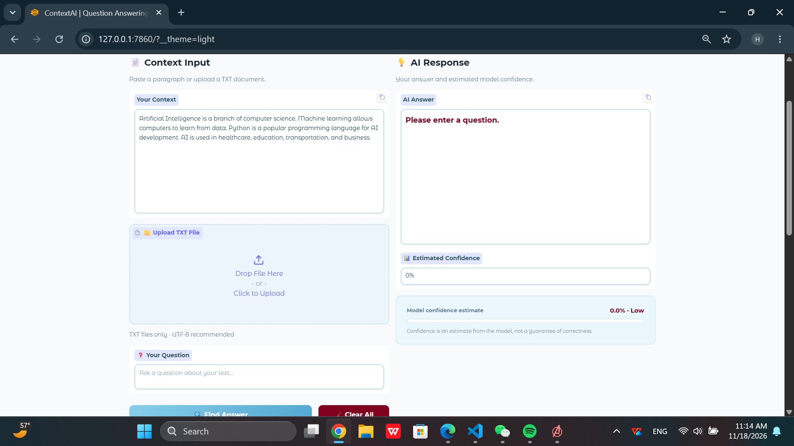
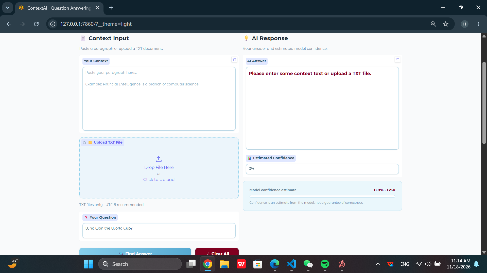

# ContextAI – Intelligent Question Answering System

**Course:** Professional Training (PT22026) · **Student:** ACHOUCH HAJAR (ID: 20243120054)

ContextAI is an interactive web app for **extractive question answering**. You paste a paragraph
(or upload a `.txt` file), ask a question, and the model highlights the answer taken directly
from your text together with a confidence score.

## Features
- Paste text or upload a UTF-8 `.txt` document as context
- Ask any question about that text
- Answer + confidence bar (High / Moderate / Low)
- Says "no confident answer" when the text does not contain the answer
- Session history of the last 10 questions, one-click examples
- Evaluation script that compares two models on SQuAD v2

## Project structure
```
.
├── app.py            # Gradio user interface (run this)
├── qa_engine.py      # Model loading and prediction logic
├── styles.py         # Custom CSS
├── evaluate.py       # Model evaluation / comparison script
├── requirements.txt  # Python dependencies
├── results/          # Evaluation output (created by evaluate.py)
└── screenshots/      # App screenshots used in this README / the report
```

## Installation
Requires **Python 3.9+**.

```bash
# 1. Clone the shared repository and enter your folder
git clone https://github.com/xahiru/PT22026.git
cd PT22026/ach054/question-answering-system         

# 2. (Recommended) create a virtual environment
python -m venv .venv
# Windows:   .venv\Scripts\activate
# Mac/Linux: source .venv/bin/activate

# 3. Install dependencies
pip install -r requirements.txt
```

## Usage
```bash
python app.py
```
Open the local URL printed in the terminal (usually http://127.0.0.1:7860).
The first run downloads the model (~500 MB) from Hugging Face, so it needs internet once.

1. Paste text into **Your Context** (or upload a TXT file).
2. Type a question and press **Find Answer** (or Enter).
3. Read the answer and the confidence bar.

Use a different model: `QA_MODEL=distilbert/distilbert-base-cased-distilled-squad python app.py`
(on Windows PowerShell: `$env:QA_MODEL="distilbert/distilbert-base-cased-distilled-squad"; python app.py`).

## Model
| Item | Details |
|---|---|
| Model | [`deepset/roberta-base-squad2`](https://huggingface.co/deepset/roberta-base-squad2) |
| Architecture | RoBERTa-base encoder (12 transformer layers, 768 hidden size, 12 attention heads, ~125M parameters) with a span-prediction head |
| Training data | SQuAD 2.0 (answerable and unanswerable questions) |
| Task | Extractive QA – the answer is always a span copied from the context |

**How it works.** The question and context are joined into one sequence
(`<s> question </s></s> context </s>`) and tokenised. RoBERTa's self-attention layers build a
contextual vector for every token. A small linear layer turns each vector into two scores: how
likely the token is the **start** of the answer and how likely it is the **end**. The best valid
(start, end) pair becomes the answer, and its probability is shown as confidence. If the
`<s>` token scores highest, the model returns "no answer". Contexts longer than 512 tokens are
split into overlapping windows (stride 128) and the best window wins.

**Capabilities:** accurate factual answers from short/medium passages, can refuse when the answer is absent.

**Limitations:**
- Can only *extract* text – cannot summarise, reason across many facts, or do arithmetic
- Knows nothing beyond the supplied context; wrong or biased context gives wrong answers
- Confidence scores are not calibrated probabilities; a confident answer can still be wrong
- English only; trained on Wikipedia-style text, so it is weaker on informal or domain-specific text
- Very long documents are processed window-by-window, so answers needing distant parts can be missed

## Evaluation
```bash
python evaluate.py --num 100
```
Results on 100 random SQuAD v2 validation questions :

| Model | EM | F1 | HasAns F1 | NoAns EM | Sec/question |
|---|---|---|---|---|---|
| distilbert-base-cased-distilled-squad | 37.0 | 39.06 | 81.37 | 0.0 | 0.538 |
| roberta-base-squad2 | 79.0 | 82.3 | 86.04 | 78.85 | 1.094 |

## Screenshots
## Screenshots

**Correct answer with confidence bar**


**Question not answerable from the text**


**Uploading a TXT file**


**Question history**


**Input validation**
 

## Datasets, models and credits
- Model: `deepset/roberta-base-squad2` by deepset (Hugging Face Model Hub)
- Comparison model: `distilbert/distilbert-base-cased-distilled-squad` (Sanh et al., 2019)
- Dataset: SQuAD 2.0 – Rajpurkar et al., 2018 (downloaded automatically by `datasets`, not stored in this repo)
- Libraries: Gradio, Hugging Face Transformers, PyTorch
