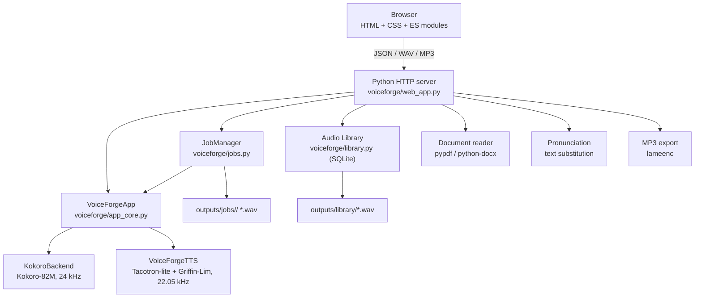
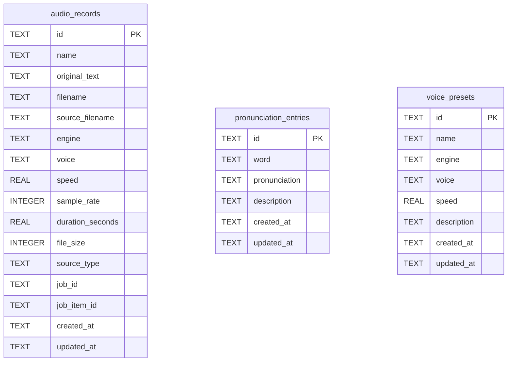

# VoiceForge — Project Summary for Report Writing

This document is the authoritative technical description of the VoiceForge
project at its final state. It is written for an AI that will generate a
university report in LaTeX. It contains verified facts only; anything not
verified in the repository or by an executed command is either marked as a
proposal or omitted.

**Source of truth:** the repository itself, the 200 Python tests, the 100
JavaScript tests, the 16 optional real-model tests, and the executed checks
recorded in `docs/report-outline.md`.

---

## 1. Project Identity

- **Project name:** VoiceForge
- **Project type:** Local web application for text-to-speech synthesis, with
  an experimental student-built acoustic model.
- **Main purpose:** convert text (typed, pasted, or extracted from PDF/DOCX)
  into speech entirely on the user's machine, store the results in a
  searchable library, and expose reusable voice settings.
- **Primary language:** Python 3.11 (backend and model code). Frontend is
  plain HTML, CSS and JavaScript ES modules — no framework and no build step.
- **Academic context (as recorded in project metadata):** course
  YN3012170034, Yunnan University; student Almaqtari Abdulrahman Mohammed
  Najib, student number 20243120042. The report author should confirm these
  details independently before submitting.
- **Scope:** English single-speaker synthesis, one local user, no cloud
  services, no authentication. Six application pages plus a pronunciation
  dictionary page and a voice-presets page (eight navigation entries in
  total; six were counted in Phase 6 because document/dictionary/preset
  pages were verified separately as part of the Phase 5 work).

---

## 2. Abstract

VoiceForge is a self-contained text-to-speech application that integrates the
pretrained Kokoro-82M model as its primary synthesis engine and implements a
small attention-based Tacotron-lite model trained on LJSpeech as an
experimental alternative. The application is served by a Python
standard-library HTTP server and a vanilla JavaScript frontend. It supports
short-text synthesis, sentence-aware long-text synthesis (up to 20,000
characters per item) with background jobs, batch generation with ZIP
downloads, document-to-speech for PDF and DOCX, a persistent SQLite audio
library with search, rename and delete, a custom pronunciation dictionary,
MP3 export, and reusable voice presets. The system is validated by 200 Python
tests, 100 JavaScript tests and 16 optional real-model tests, all passing at
the final commit, and by browser checks across four viewport sizes. The custom
model is presented honestly as experimental: it is usable but clearly less
natural than Kokoro.

---

## 3. Problem Statement

Text-to-speech (TTS) is useful for accessibility, language learning, content
production and hands-free reading, but many practical tools depend on cloud
APIs that require accounts, network access and data sharing. A local
application avoids those constraints and makes experimentation with open
models possible.

VoiceForge addresses three practical problems:

1. **Accessible local synthesis:** a user can type or upload text and get a
   WAV/MP3 without sending content to a third party.
2. **Realistic workflows:** real text is often longer than one sentence, comes
   in batches, or lives in documents; the application therefore provides
   long-text jobs, batch processing and document extraction rather than a
   single text box.
3. **Reuse and control:** generated audio should be findable later, and
   recurring preferences (voice, speed, pronunciation of names) should be
   reusable rather than retyped.

The project also has an educational objective: compare a strong pretrained
model with a student-implemented Tacotron-lite model, and document the gap
honestly.

---

## 4. Objectives

1. Build a working, local TTS web application with no cloud dependency at
   runtime.
2. Integrate Kokoro-82M as the primary engine (voices, speed control,
   phonemisation).
3. Implement a small custom Tacotron-lite model with a Griffin–Lim vocoder
   and train it on LJSpeech as a learning artefact.
4. Provide long-text synthesis, batch synthesis with background jobs, and
   document-to-speech.
5. Persist generated audio in SQLite with search, filtering, sorting,
   renaming and deletion.
6. Offer pronunciation rules, MP3 export and voice presets integrated into
   every generation workflow.
7. Keep the code testable and safe: parameterised SQL, validated uploads,
   no internal details in error responses, reproducible automated tests.
8. Produce accurate documentation, a report outline and a demonstration
   plan.

---

## 5. Functional Requirements (implemented)

- Generate speech from English text (short text limit: 400 characters).
- Select engine (Kokoro or custom), Kokoro voice (7 US-English voices) and
  speed (0.5–2.0, Kokoro only; the custom engine has no speed control).
- Play and download WAV; export MP3 at 128/192/320 kbps.
- Long-text mode up to 20,000 characters per item, split into sentences and
  chunks, synthesised as a background job and joined into one WAV.
- Batch Studio: up to 20 entries, add/edit/remove, upload `.txt` files
  (max 20 files, 1 MB each, 5 MB total), one job, per-item progress,
  individual WAV/MP3, ZIP with manifest, partial-failure handling.
- Audio Library: persistent records, search by name/text, filter by engine
  and source, sort by newest/oldest/name/duration, pagination, rename,
  delete (record + WAV), playback, WAV and MP3 download.
- Document to Speech: upload PDF or DOCX (max 10 MB), extract text, edit it,
  then synthesise through the long-text job workflow.
- Pronunciation dictionary: add/edit/delete/search rules; case-insensitive
  whole-word/phrase matching; applied before chunking in Studio, Batch,
  Long Text and Documents; toggle per request.
- Voice presets: create/edit/delete; validated against live engine
  capabilities; applicable in Studio, Batch and Documents.
- Job API: submit, poll, download ZIP, download individual audio.

---

## 6. Non-functional Requirements (design considerations)

- **Local-first:** no network calls at runtime except optional model download
  on first use and no external APIs.
- **Usability:** six working pages with consistent styling, keyboard
  shortcuts, loading states, empty states and clear error messages.
- **Reliability:** automated tests; defensive validation; transactional
  deletion; graceful handling of missing files.
- **Maintainability:** single synthesis entry point (`app_core.py`), separated
  modules (jobs, library, text splitter, audio join, uploads, pronunciation,
  documents, MP3, cache), vanilla ES modules per page.
- **Security:** parameterised SQL, upload size/type validation, path
  containment, no tracebacks to clients, fixed-argument subprocess use.
- **Compatibility:** Windows 10/11 and Python 3.11; CPU or CUDA PyTorch;
  no external binaries required (MP3 uses `lameenc`).
- **Honesty:** the custom model is documented as experimental, and no
  unmeasured performance claims are made.

Verified status is reported in `## 17 Results`; these are design goals, not
blanket guarantees.

---

## 7. Technology Stack

| Layer | Technology | Role |
|---|---|---|
| Language | Python 3.11.9 | Backend, model code, tooling |
| HTTP | `http.server.ThreadingHTTPServer` | Serves API, static frontend and audio |
| Frontend | HTML5, CSS3, JavaScript ES modules | UI, no framework/build step |
| Database | SQLite via `sqlite3` (stdlib) | Audio records, dictionary, presets |
| Primary TTS | `kokoro` 0.9.4 + Kokoro-82M weights | Speech synthesis, 24 kHz |
| G2P | `misaki` (English) with espeak fallback | Text→phoneme conversion for Kokoro |
| Custom TTS | PyTorch 2.14.1, torchaudio 2.11.0 | Tacotron-lite + Griffin–Lim, 22.05 kHz |
| Audio I/O | `soundfile` 0.14.0, NumPy 2.4.6 | WAV read/write, chunk joining |
| MP3 | `lameenc` 1.9.0 (FFmpeg fallback) | MP3 encoding, 128/192/320 kbps |
| PDF | `pypdf` 7.1.0 | Text extraction |
| DOCX | `python-docx` 1.2.0 | Paragraph/table extraction |
| Testing | `pytest` 9.2.0, Node.js test runner | Python and JavaScript tests |
| Browser QA | Headless Microsoft Edge + Chrome DevTools Protocol | Manual automation checks |

`requirements.txt` lists: torch, torchaudio, numpy, soundfile, kokoro, pypdf,
python-docx, lameenc, pytest.

---

## 8. System Architecture



- The frontend uses `fetch` only through small API modules; each page is an
  ES module.
- The server exposes JSON endpoints under `/api/*`, static assets under
  `/css`, `/js`, `/assets`, and audio under `/audio` and `/api/library/...`.
- `VoiceForgeApp` owns the model instances and a lock; every synthesis path
  (Studio, jobs, documents) calls it.
- `JobManager` has one worker thread and a bounded queue; it applies the
  pronunciation snapshot before chunking and records results in the library.
- SQLite stores metadata; WAV files live under `outputs/` (git-ignored).
- Document extraction and MP3 conversion are separate modules, not part of
  the synthesis core.

---

## 9. Project Directory Structure

```text
alm042/
├── app.py                    # Launches the web application
├── app_gradio.py             # Optional legacy Gradio frontend
├── requirements.txt
├── README.md
├── PROJECT_SUMMARY.md        # This document
├── .gitignore
├── voiceforge/               # Backend package
│   ├── __init__.py
│   ├── app_core.py           # Central synthesis entry point
│   ├── architectures.py      # Architecture identifiers
│   ├── audio.py              # Audio I/O, Mel, Griffin-Lim
│   ├── audio_join.py         # WAV chunk joining (150 ms gaps)
│   ├── batching.py           # Padding/collation/length bucketing
│   ├── cache.py              # MP3 cache cleanup policy
│   ├── checkpoint.py         # Save/load + architecture dispatch
│   ├── dataset.py            # LJSpeech loader + Mel cache
│   ├── document_reader.py    # PDF/DOCX text extraction
│   ├── jobs.py               # Background job queue and worker
│   ├── kokoro_backend.py     # Kokoro-82M integration
│   ├── library.py            # SQLite library, dictionary, presets
│   ├── model.py              # Tacotron-lite model
│   ├── model_legacy.py       # Original baseline model
│   ├── mp3.py                # WAV→MP3 conversion + cache
│   ├── pronunciation.py      # Dictionary substitution
│   ├── text.py               # Normalisation and vocabulary
│   ├── text_split.py         # Sentence-aware splitter
│   ├── training.py           # Training loop and losses
│   ├── tts.py                # VoiceForgeTTS inference pipeline
│   ├── uploads.py            # TXT upload validation
│   └── web_app.py            # HTTP routes, static serving, errors
├── frontend/
│   ├── index.html            # Application shell
│   ├── package.json          # Marks ES modules for Node tests
│   ├── css/                  # style.css, layout.css, components.css
│   ├── assets/favicon.svg
│   ├── js/
│   │   ├── app.js            # Navigation/bootstrap
│   │   ├── api.js            # Generation API client
│   │   ├── advanced-api.js   # Documents/dictionary/presets client
│   │   ├── advanced-state.js # Pure helpers for Phase 5 features
│   │   ├── batch-state.js    # Batch entry state
│   │   ├── engine-ui.js      # Engine/voice/speed rules
│   │   ├── job-format.js     # Job formatting helpers
│   │   ├── jobs.js           # Job API + poller
│   │   ├── keyboard.js       # Enter/Shift+Enter/Ctrl+Enter rules
│   │   ├── library-api.js    # Library client
│   │   ├── library-state.js  # Library helpers
│   │   ├── state.js          # Store + generation gate
│   │   ├── upload.js         # TXT upload validation
│   │   ├── validation.js     # Text rules
│   │   ├── components/       # audio player, job view, extras, notifications
│   │   └── pages/            # studio, batch, library, documents,
│   │                         # pronunciation, presets, coming-soon
│   └── tests/                # Node test runner suites (100 tests)
├── tests/                    # pytest suites (200 tests) + conftest
├── scripts/                  # train.py, generate.py, evaluate.py,
│                             # check_audio.py, check_text_vocabulary.py
├── docs/                     # api.md, architecture.md, evaluation.md,
│                             # kokoro.md, training-v2.md, report-outline.md,
│                             # demo-plan.md
└── outputs/                  # Runtime only, git-ignored
    ├── app/                  # Studio WAV files
    ├── jobs/                 # Job WAV files and ZIP sources
    ├── library/              # Library WAV copies
    ├── library.db            # SQLite database
    ├── mp3/                  # MP3 cache
    └── hf/                   # Hugging Face cache fallback
```

Tests are intentionally kept flat in `tests/` because all suites share one
`conftest.py` with HTTP-server fixtures; moving them into subpackages would
add import complexity without improving clarity. JavaScript tests live next
to the frontend in `frontend/tests/` because they import ES modules directly.

---

## 10. TTS Engine Selection

### Kokoro-82M (primary engine)

- **What it is:** an open-weight neural TTS model (≈82 million parameters)
  published by hexgrad, served through the `kokoro` Python package.
- **Why selected:** high naturalness for its size, simple CPU/GPU inference,
  Apache-2.0 licence, and an English G2P pipeline (`misaki` with espeak
  fallback) that made integration practical.
- **Integration:** `voiceforge/kokoro_backend.py` lazily loads
  `KPipeline(lang_code="a")`, caches it, and calls
  `pipeline(text, voice=..., speed=...)`. Speed is a per-call argument, so no
  pipeline rebuild is needed; the cached model is reused.
- **Verified properties:** 24,000 Hz output; 7 US-English voices
  (`af_heart`, `af_bella`, `af_nicole`, `af_sky`, `am_michael`, `am_fenrir`,
  `am_puck`); speed 0.5–2.0; license Apache-2.0 (model card:
  <https://huggingface.co/hexgrad/Kokoro-82M>).
- **Weights:** downloaded on first use (~330 MB total with voices); the
  project falls back to `outputs/hf` if the default cache is not writable.

### Experimental custom model (VoiceForge)

- **Architecture:** Tacotron-lite — an attention-based encoder/decoder
  acoustic model producing Mel spectrograms, paired with a Griffin–Lim
  vocoder. 22,050 Hz output, 38-character vocabulary (English letters and
  basic punctuation).
- **Training:** trained on LJSpeech; the dataset is not committed (large,
  downloaded separately). Training/evaluation entry points live in
  `scripts/`; design notes in `docs/architecture.md` and
  `docs/training-v2.md`.
- **Capabilities:** single speaker, text without digits, WAV output.
- **Limitations:** audibly robotic/buzzy prosody, unreliable long utterances,
  no voice selection, no speed control, digits rejected. It is not the
  primary engine and no naturalness claim is made.

---

## 11. Main Application Features

### 11.1 Speech Studio (`/`)

- **Purpose:** short-text synthesis (≤400 characters).
- **Workflow:** type/paste → choose engine, voice, speed, optional preset and
  pronunciation toggle → Generate (button or Enter; Shift+Enter = newline).
- **Backend:** `POST /api/generate` → validation → optional dictionary
  substitution → `VoiceForgeApp.synthesize` → WAV in `outputs/app/` →
  library record.
- **Storage:** WAV on disk, metadata in SQLite, response includes
  `library_id` and `mp3_url`.

### 11.2 Long Text

- **Purpose:** synthesise up to 20,000 characters per item.
- **Workflow:** switch to Long text mode; Enter inserts a newline,
  Ctrl/Cmd+Enter submits; progress shown per job; final joined WAV.
- **Backend:** `POST /api/jobs` type `long_text` → sentence-aware splitter →
  chunks ≤380 chars (Kokoro) or ≤250 (custom) → synthesis per chunk →
  `join_wav_files` with 150 ms gaps → one library record.
- **Storage:** `outputs/jobs/<job_id>/<item>.wav` plus a library copy.

### 11.3 Batch Studio

- **Purpose:** several entries in one job.
- **Workflow:** add/edit/remove entries, upload `.txt` files, choose settings,
  submit; per-item status, WAV/MP3 links, ZIP download.
- **Backend:** `POST /api/jobs` type `batch`; one record per successful item;
  failures reported per item and in the manifest.
- **Limits:** 20 entries, 4 active jobs (further submissions get HTTP 429).

### 11.4 Audio Library

- **Purpose:** persistent, searchable history of every recording.
- **Workflow:** search, filter, sort, paginate, play, rename, delete,
  download WAV/MP3.
- **Backend:** `GET /api/library`, `GET/PATCH/DELETE /api/library/{id}`,
  `GET /api/library/{id}/audio`, `GET /api/library/{id}/mp3`.
- **Storage:** SQLite `audio_records` plus `outputs/library/*.wav`.

### 11.5 Document to Speech

- **Purpose:** read PDF/DOCX content aloud.
- **Workflow:** upload (max 10 MB) → extracted text appears in an editable
  box → settings/preset/pronunciation → generate job → result saved in the
  library.
- **Backend:** `POST /api/documents/extract`, then the long-text job API.
- **Limitations:** no OCR for scanned PDFs; encrypted PDFs rejected;
  corrupted files rejected; DOCX has no page count.

### 11.6 Pronunciation Dictionary

- **Purpose:** control how names and terms are pronounced.
- **Workflow:** add/edit/delete/search rules; the toggle in generation pages
  enables substitution.
- **Backend:** `GET/POST /api/pronunciation`, `PATCH/DELETE /api/pronunciation/{id}`.
- **Mechanism:** case-insensitive, whole-word/phrase, longest-match,
  single-pass replacement of the word with a phonetic respelling before
  chunking; the engine's G2P then converts the respelling to phonemes.
- **Verification:** real test shows different phoneme strings
  (`ˈæbdəlɹˌɑmən` vs `ˈæbdˈulɹˈɑmˈæn`) and different audio. This proves the
  rule reaches the model; it does not prove perfect pronunciation.

### 11.7 Voice Presets

- **Purpose:** save engine/voice/speed combinations.
- **Workflow:** create/edit/delete on the presets page; apply from a dropdown
  in Studio, Batch or Documents (applying does not start generation).
- **Backend:** `GET/POST /api/presets`, `PATCH/DELETE /api/presets/{id}`.
- **Validation:** engine must exist; Kokoro voice must exist; speed must be
  0.5–2.0; custom-engine presets store no voice or speed.

### 11.8 MP3 export

- **Purpose:** portable audio alongside WAV.
- **Where:** library card, batch item, batch ZIP, studio result.
- **Backend:** `GET /api/library/{id}/mp3?bitrate=…`,
  `GET /api/jobs/{id}/download?format=mp3&bitrate=…`,
  `GET /api/jobs/{id}/audio/{item}?format=mp3`.

---

## 12. Text Processing and Audio Generation

1. **Validation:** `VoiceForgeApp.validate_text` rejects non-strings, empty
   text, >400 characters (short path), and characters outside the custom
   model's vocabulary.
2. **Pronunciation:** `apply_dictionary(text, entries)` performs a single
   regex pass with lookarounds `(?<!\\w)…(?!\\w)`, longest alternatives first,
   case-insensitive; replacement text is never rescanned.
3. **Long-text splitting:** `split_text(text, max_chars)` splits on
   `.`/`!`/`?`/ellipsis and line breaks, protects abbreviations (`Dr.`,
   `e.g.`), initials and decimals (3.14), packs sentences up to the limit,
   wraps over-long sentences at spaces and hard-splits a giant word without
   losing characters. No empty chunks; word order preserved.
4. **Chunk sizes:** Kokoro 380 characters, custom 250 (both within the
   400-character validation limit).
5. **Synthesis:** Kokoro chunks go to `KPipeline` with the selected voice and
   speed; custom chunks go through the Tacotron-lite decoder + Griffin–Lim
   (2 iterations in tests, configured value in production).
6. **Joining:** `join_wav_files` requires identical sample rates, converts
   mono/stereo consistently, inserts 150 ms of silence between chunks,
   scales peaks above 0.95 to avoid clipping, and writes 16-bit PCM.
7. **Duration/size:** measured from the written file (`soundfile.info`).

---

## 13. Database Design

- **Engine:** SQLite (stdlib `sqlite3`), file `outputs/library.db`,
  WAL journal mode, one connection per operation, short transactions.
- **Initialization:** `Library.__init__` creates directories, runs the
  idempotent schema script and sets `PRAGMA user_version`. Existing data is
  never dropped.
- **Migration:** version 1 → 2 adds the dictionary and preset tables; an
  existing v1 database upgrades in place (tested).



- **Indexes:** `created_at`, `name COLLATE NOCASE`, `engine`, `source_type`,
  unique `source_filename`, unique `(job_id, job_item_id)`.
- **Relationships:** intentionally no foreign keys between tables; job
  identifiers are stored for traceability only.
- **Idempotency:** a generated file or job item can be recorded only once,
  so repeated polling cannot duplicate records.
- **Deletion:** the row is deleted inside a transaction; the WAV is removed
  before commit; if removal fails, the transaction rolls back so the library
  never keeps a record whose file silently vanished. Missing files are
  tolerated.

---

## 14. API Design

All responses are JSON except audio/zip. Errors use one shape:

```json
{"ok": false, "error": "human message", "code": "machine_code"}
```

### Discovery and generation
| Method | Path | Purpose |
|---|---|---|
| GET | `/health` | Legacy status and engine summary |
| GET | `/api/engines` | Engines, voices, language, sample rate, speed range, limits, capabilities |
| POST | `/generate` | Legacy generation (same implementation) |
| POST | `/api/generate` | `{text, engine, voice?, speed?, pronunciation?}` |
| GET | `/audio/<file>` | Studio WAV playback/download |

### Jobs
| Method | Path | Purpose |
|---|---|---|
| POST | `/api/jobs` | Submit `long_text` or `batch` job |
| GET | `/api/jobs/{id}` | Job and item status |
| GET | `/api/jobs/{id}/audio/{item}` | One WAV (`?format=mp3`) |
| GET | `/api/jobs/{id}/download` | ZIP (`?format=wav|mp3`, `bitrate`) |

### Library
| Method | Path | Purpose |
|---|---|---|
| GET | `/api/library` | `q, sort, engine, source, page, limit` |
| GET | `/api/library/{id}` | One record |
| PATCH | `/api/library/{id}` | Rename |
| DELETE | `/api/library/{id}` | Delete record and WAV |
| GET | `/api/library/{id}/audio` | WAV (`?download=1`) |
| GET | `/api/library/{id}/mp3` | MP3 (`?bitrate=128|192|320`) |

### Documents, dictionary, presets
| Method | Path | Purpose |
|---|---|---|
| POST | `/api/documents/extract` | `{name, data_base64}` → text |
| GET/POST | `/api/pronunciation` | List/search, add |
| PATCH/DELETE | `/api/pronunciation/{id}` | Edit, delete |
| GET/POST | `/api/presets` | List, create |
| PATCH/DELETE | `/api/presets/{id}` | Edit, delete |
| POST | `/api/uploads` | TXT uploads `{files:[{name,data_base64}]}` |

Error codes include: `invalid_engine`, `invalid_voice`, `invalid_speed`,
`speed_not_supported`, `empty_text`, `text_too_long`, `unsupported_characters`,
`queue_full` (429), `job_not_found`, `no_results` (409), `record_not_found`,
`invalid_name`, `invalid_sort`, `unsupported_file`, `upload_too_large` (413),
`invalid_encoding`, `document_too_large` (413), `invalid_document`,
`encrypted_document`, `no_extractable_text`, `invalid_bitrate`,
`mp3_unavailable` (503), `internal_error` (500).

---

## 15. Security Considerations

**Implemented protections (tested):**

- Uploads: extension allow-list, per-file and total size limits, strict
  base64, strict UTF-8 with BOM stripping, filename reduced to basename and
  sanitised; uploaded names never become filesystem paths.
- Documents: 10 MB limit, parser errors mapped to safe messages, no macros
  or embedded content executed, no files written for extraction.
- Path traversal: static serving has an extension allow-list, `..` rejection
  and resolved-path containment; audio and library routes resolve stored
  names inside their directories only.
- SQL: every query parameterised; sort options are a fixed whitelist; search
  terms escaped for `LIKE`.
- Downloads: server-generated filenames; MP3 content type `audio/mpeg`.
- Archives: entries built from job records with sanitised names; no absolute
  paths or `..`.
- Errors: one JSON shape; unexpected exceptions are logged server-side and
  returned as generic 500 JSON without tracebacks or paths.
- MP3: `lameenc` in-process; FFmpeg (if used) invoked with a fixed argument
  list, `shell=False`, timeout; output header validated.
- Concurrency: a single model lock; bounded job queue (4 active jobs).

**Remaining risks (documented):**

- No authentication; the server binds to `127.0.0.1` by default, but exposing
  it to a network would allow anyone to generate audio and read the library.
- No rate limiting beyond the job queue.
- SQLite and files are protected only by filesystem permissions.
- `app_gradio.py` is legacy and was not exercised in the final QA.

---

## 16. Testing Methodology

- **Python tests (`tests/`, 200 passed):** unit tests for the splitter, audio
  joining, pronunciation matching, MP3 conversion, cache cleanup and document
  extraction; API/integration tests for generation, jobs, uploads, library,
  documents, dictionary, presets and MP3; security tests for traversal,
  malformed input and error shapes; migration and persistence tests.
- **JavaScript tests (`frontend/tests/`, 100 passed):** pure-function tests
  for keyboard rules, validation, engine UI, library helpers, advanced
  features, job formatting, upload validation and API clients (mocked
  `fetch`).
- **Real-model tests (`tests/test_kokoro_api.py`, 16 passed when enabled):**
  gated by `VOICEFORGE_TEST_KOKORO=1`; use cached Kokoro weights; cover
  generation, speed, long text + ZIP, batch, library persistence,
  pronunciation (phoneme and audio difference), documents, MP3 and presets.
  Without the variable they are skipped (16 skips, reported not hidden).
- **Browser QA:** headless Edge via CDP; all pages at 1440×900, 1366×768,
  768×1024 and 390×844; 24 checks with zero horizontal overflow and zero
  uncaught JS exceptions; real generation, downloads, rename/delete,
  dictionary and presets exercised in earlier runs.
- **Manual workflows:** documented in `docs/demo-plan.md` and exercised
  during Phases 3–6.

No Playwright/Cypress end-to-end suite exists; browser checks were scripted
CDP sessions, not a CI test suite.

---

## 17. Results and Discussion

Verified outcomes at the final commit:

- All automated tests pass: **200 Python, 100 JavaScript, 16 real-model**.
- The six/ eight pages render at four viewport sizes with no overflow.
- Real Kokoro generation works for short text, long text (multi-chunk joined
  WAV), batches, documents and MP3 export.
- Library records persist across a server restart (verified by restart and
  re-reading the API).
- Pronunciation rules demonstrably change the phoneme string and the audio.
- Presets are validated against live engine data and applied by jobs.
- Upload validation rejects wrong extensions, oversized files, invalid
  encodings and traversal attempts.

What these results demonstrate: correctness of the implemented workflows and
the honesty of the documented limits. They do **not** demonstrate perceptual
quality, latency under load, or multi-user behaviour; no such measurements
were performed.

---

## 18. Limitations

1. **No OCR:** scanned/image PDFs are rejected with an explanation.
2. **Res pronunciation is respelling-based:** not direct phoneme injection;
   accuracy depends on the spelling and the engine's G2P.
3. **Job history is in memory:** status and ZIP links vanish on restart
   (library records and WAVs persist).
4. **One background worker and a 4-job queue:** long jobs delay later ones.
5. **No authentication**; designed for local single-user use.
6. **Custom model is experimental:** robotic prosody, single speaker, digits
   unsupported, no speed/voice control.
7. **No automated browser E2E suite** (scripts were run manually).
8. **MP3 cache cleanup** covers `outputs/mp3/`; job-specific MP3s under
   `outputs/jobs/` are not auto-cleaned.
9. **No controlled latency/RTF benchmark**; no performance numbers claimed.
10. **English only.**
11. **`app_gradio.py` is legacy** and not part of the verified QA.

---

## 19. Future Work (proposals, not implemented)

- Persist job history in SQLite (jobs survive restart).
- OCR for scanned PDFs (e.g., Tesseract) with explicit quality caveats.
- Phoneme-level lexicon using misaki's phoneme output.
- Multi-speaker or fine-tuned custom model.
- Streaming synthesis and progress-aware cancellation.
- Automated Playwright/Cypress E2E suite in CI.
- Optional authentication if the app is ever exposed beyond localhost.
- Batch presets and per-item preset overrides.
- Cache management UI and configurable retention.

---

## 20. Conclusion

VoiceForge demonstrates that a practical, privacy-preserving TTS application
can be built with a standard-library Python backend, vanilla web frontend,
SQLite persistence and an open-weight model. The Kokoro integration delivers
the usable experience; the Tacotron-lite model documents the difficulty of
training natural speech from scratch. The system is tested at three levels
(unit/integration, real-model, browser), with honest documentation of its
limits. The custom model remains experimental and the application remains a
single-user local tool; neither is presented as production software.

---

## 21. References

1. Wang, Y., Skerry-Ryan, R. J., Stanton, D., Wu, Y., Weiss, R. J., Jaitly,
   N., Yang, Z., Ying, Z., Senior, A., Vinyals, O., et al. (2017).
   *Tacotron: Towards End-to-End Speech Synthesis.* arXiv:1703.10135.
   https://arxiv.org/abs/1703.10135
2. Griffin, D. W. and Lim, J. S. (1984). *Signal Estimation from Modified
   Short-Time Fourier Transform.* IEEE Transactions on Acoustics, Speech,
   and Signal Processing, 32(2), 236–243.
3. hexgrad. *Kokoro-82M* model card. Hugging Face.
   https://huggingface.co/hexgrad/Kokoro-82M (Apache-2.0).
4. hexgrad. *kokoro* Python package. https://github.com/hexgrad/kokoro
5. hexgrad. *misaki* grapheme-to-phoneme library.
   https://github.com/hexgrad/misaki
6. SQLite Consortium. *SQLite Documentation.* https://www.sqlite.org/docs.html
7. Python Software Foundation. *Python 3.11 Documentation.*
   https://docs.python.org/3.11/
8. pypdf contributors. *pypdf Documentation.*
   https://pypdf.readthedocs.io/
9. python-docx contributors. *python-docx Documentation.*
   https://python-docx.readthedocs.io/
10. The LAME Project. *LAME MP3 Encoder.* https://lame.sourceforge.io/
11. lameenc Python package. https://pypi.org/project/lameenc/
12. Fielding, R., Nottingham, M., Reschke, J. (2022). *HTTP Semantics.*
    RFC 9110. https://www.rfc-editor.org/rfc/rfc9110
13. IEEE. *IEEE Standard for Floating-Point Arithmetic (IEEE 754-2019)* —
    only if a report discusses numeric precision; otherwise optional.

---

## 22. Verified Fact Sheet

| Fact | Value | Verified by |
|---|---|---|
| Python version | 3.11.9 | `python --version` |
| Primary model | Kokoro-82M (`hexgrad/Kokoro-82M`) | `/api/engines`, model card |
| Kokoro sample rate | 24 000 Hz | engine description, WAV headers |
| Kokoro voices | 7 US-English | `/api/engines` |
| Speed range | 0.5–2.0 (Kokoro only) | engine description, validation tests |
| Custom model sample rate | 22 050 Hz | engine description |
| Short-text limit | 400 characters | `/api/engines` |
| Long-text limit | 20 000 characters per item | splitter/job validation |
| Chunk sizes | 380 (Kokoro), 250 (custom) | `jobs.CHUNK_LIMITS` |
| Chunk gap | 150 ms | `audio_join.DEFAULT_GAP_SECONDS` |
| Batch items | 20 per job | job validation |
| Active jobs | 4 (HTTP 429 beyond) | job manager tests |
| TXT uploads | 20 files, 1 MB each, 5 MB total | `uploads.py` |
| Documents | PDF/DOCX, 10 MB | `document_reader.py` |
| MP3 bitrates | 128 / 192 / 320 kbps | `mp3.py` |
| Body limit | 15 MB | `web_app.MAX_BODY_BYTES` |
| Database | SQLite, schema v2, WAL | `library.py` |
| Tables | `audio_records`, `pronunciation_entries`, `voice_presets` | schema |
| Python tests | 200 passed | pytest |
| Python skips | 16 (real-Kokoro, gated) | pytest summary |
| Real-model tests | 16 passed when enabled | gated pytest |
| JavaScript tests | 100 passed | `node --test` |
| Browser checks | 24 (6 pages × 4 sizes), 0 overflow, 0 exceptions | CDP run |

---

## 23. Claims to Avoid

The report-writing AI must **not** claim:

- That the custom Tacotron-lite model produces natural or high-quality
  speech. It is experimental and audibly robotic.
- That scanned PDFs are supported (OCR is not implemented).
- That job status or job ZIP links survive a server restart.
- Any latency, real-time factor, MOS, WER or user-satisfaction number — none
  were measured.
- That pronunciation rules guarantee correct pronunciation; they change the
  text before G2P and were verified to change phonemes/audio only.
- That mocked tests are real-model tests; the 16 gated tests are the only
  real-Kokoro ones.
- That the application is production-ready, multi-user, or authenticated.
- That MP3 auto-cleanup covers job-specific MP3 files.
- That there is an automated browser E2E test suite (checks were scripted
  CDP sessions).
- That every feature of `app_gradio.py` was tested.

---

## 24. Report-Writing Guidance

- Use this document as the primary technical source; consult `README.md`,
  `docs/architecture.md`, `docs/kokoro.md` and `docs/report-outline.md` for
  further detail.
- Do not invent details that are not present. If a fact is missing, ask the
  author instead of filling the gap.
- Keep the two engines clearly separated: Kokoro-82M (pretrained, primary)
  and the custom Tacotron-lite model (student-built, experimental).
- Describe only implemented features as implemented; mark future work as
  proposals.
- Present the test results exactly as listed (200/100/16) and explain the 16
  skips as environment-gated real-model tests.
- Use academic language, cite the references in Section 21, and include the
  architecture, workflow and ER diagrams (Mermaid source is above; render or
  redraw them for LaTeX).
- Preserve project terminology: Speech Studio, Long Text, Batch Studio,
  Audio Library, Document to Speech, Pronunciation Dictionary, Voice Presets.
- State limitations explicitly in the discussion rather than omitting them.
