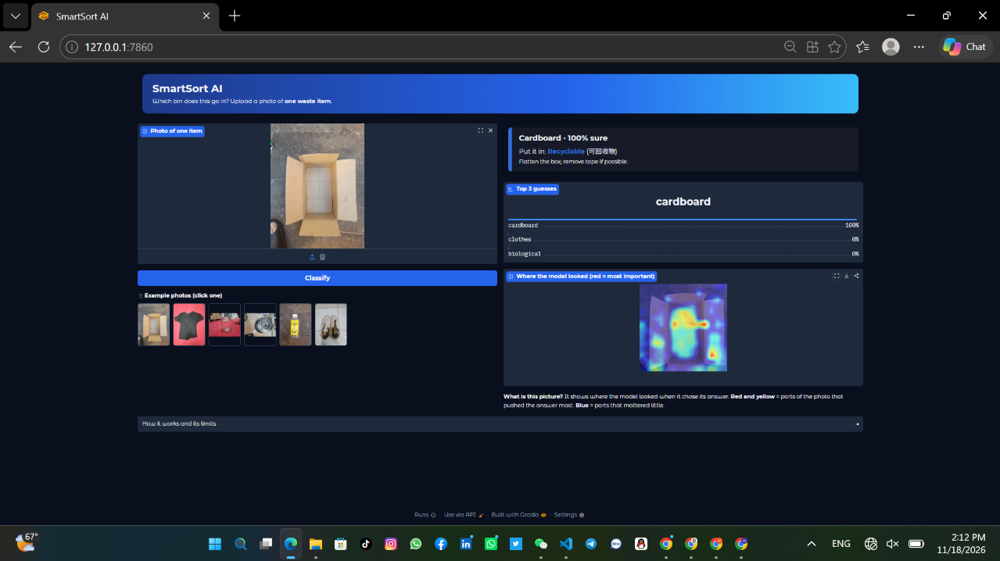

# SmartSort AI

Upload a photo of **one waste item** and get its material class, the right bin (China's four-bin system) and a heatmap that shows where the model looked.



## Features
- Classifies a photo into 10 classes: battery, biological, cardboard, clothes, glass, metal, paper, plastic, shoes, trash.
- Gives bin advice in English and Chinese (Recyclable 可回收物, Kitchen waste 厨余垃圾, Hazardous waste 有害垃圾, Other waste 其他垃圾) with a short tip.
- Shows a Grad-CAM heatmap (red = parts that influenced the answer most).
- Says "I'm not sure" when the model is less than 90% confident.
- Handles bad input: blank, tiny, damaged or empty files, sideways phone photos, very large photos.
- Works offline after the model has been downloaded once.

## Model summary and results
The final model is **E3: ViT-B/16** (`google/vit-base-patch16-224`), fully fine-tuned on the cleaned dataset (AdamW, learning rate 2e-5, batch size 32, 8 epochs, 10% warm-up, cosine decay, fp16, seed 42, Google Colab T4, 21 minutes). The baseline is a fine-tuned ResNet-50. The final model was chosen by validation macro-F1 only. The test split and the real photos were used once, at the end.

| Model | Val macro-F1 | Test accuracy | Test macro-F1 | Real-photo accuracy | Real-photo macro-F1 | Real-photo bin accuracy |
|---|---|---|---|---|---|---|
| E1 ResNet-50 (all layers) | 0.9682 | 0.9724 | 0.9650 | 0.495 | 0.484 | 0.752 |
| E2 ViT, head only | 0.9710 | 0.9742 | 0.9646 | 0.593 | 0.586 | 0.780 |
| **E3 ViT, full fine-tuning (final)** | **0.9825** | **0.9802** | **0.9734** | 0.570 | 0.558 | 0.776 |
| E4 ViT, full, strong augmentation | 0.9777 | 0.9780 | 0.9691 | 0.575 | 0.561 | 0.776 |

- **Test split:** 2,323 images from the same dataset. **Real photos:** 214 photos taken with my own phone (Samsung S24).
- Accuracy drops from about 98% on the test split to about 57% on real phone photos. With 214 photos the margin of error is about 6.5 points, so the models cannot be ranked on real photos.
- "Bin accuracy" counts an answer as right if it points to the right bin, even when the class is wrong (for example plastic instead of metal).
- Speed on a 4-thread laptop CPU: about 0.3 s per photo for E3 (343 MB), about 0.15 s for E1 (94 MB).
- The model in the app gives the same answer as the evaluation on all 214 real photos.

## Installation (Windows)
Tested with Python 3.11.

```powershell
git clone -b smartsort-ans082 https://github.com/ansari-ai-dev/PT22026.git
cd PT22026\ans082
py -3.11 -m venv .venv
Set-ExecutionPolicy -Scope Process -ExecutionPolicy RemoteSigned
.venv\Scripts\Activate.ps1
python -m pip install --upgrade pip
pip install -r requirements.
If the downloads are slow or fail (for example in China), try more retries and a mirror:

```powershell
pip install -r requirements.txt --default-timeout 120 --retries 10 -i https://pypi.tuna.tsinghua.edu.cn/simple
```
python -m pytest -q
```

The last command runs the 58 tests (about 30 seconds).

## Dataset
- **Garbage Classification (12 classes)**, Kaggle user `mostafaabla`: https://www.kaggle.com/datasets/mostafaabla/garbage-classification (15,515 images).
- **Licence:** database under ODbL-1.0, contents belong to the original authors. The images are used for coursework only and are **not** included in this repository.
- **Changes:** the three glass classes were merged into `glass` (10 classes); 22 exact duplicates were removed; near-duplicates are kept in the same split. Result: 15,493 images split 70/15/15 (stratified, seed 42) in `splits/split_v1.csv`. Details are in `docs/dataset_notes.md`.
- **Real photos:** 214 photos of waste items taken with my own phone, 19 to 28 per class, with different backgrounds, lighting and angles. They are not in the repository. They were never used for training or tuning. See `docs/real_photo_audit.md` for label problems found afterwards.
- To download the dataset, use the Kaggle page above and save the ZIP file.

## Model download
The final model is on Hugging Face: https://huggingface.co/ansari-ai-dev/smartsort-vit-waste

The app downloads it automatically on the first start (about 350 MB) into `models/smartsort-vit-waste`. After that it works without internet. If huggingface.co cannot be reached, you have two options:
- Set a community mirror before starting the app: `$env:HF_ENDPOINT = "https://hf-mirror.com"`.
- Download the files by hand from the "Files" tab of the Hugging Face page (`config.json`, `model.safetensors`, `preprocessor_config.json`) and put them in `models/smartsort-vit-waste`.

## How to run the app
```powershell
python app/app.py
```
The page opens at http://127.0.0.1:7860. Optional settings (environment variables): `SMARTSORT_MODEL_DIR` (model folder), `SMARTSORT_THRESHOLD` (default 0.90), `SMARTSORT_PORT` (default 7860).

## How to reproduce training (Google Colab)
1. Put the Kaggle ZIP on Google Drive as `SmartSort_AI/data/garbage-classification.zip`, and unzip it in Colab to `/content/data/garbage_classification`.
2. In Colab (GPU runtime), mount Drive and clone the repository:
   ```
   !git clone -b smartsort-ans082 https://github.com/ansari-ai-dev/PT22026.git /content/PT22026
   %cd /content/PT22026/ans082
   !pip install -q -r requirements-colab.txt
   ```
3. Train (the settings are in the config files; checkpoints and logs go to Drive):
   ```
   !python src/train.py --config configs/resnet50.yaml            # E1
   !python src/train.py --config configs/vit_head_only.yaml       # E2
   !python src/train.py --config configs/vit_full.yaml            # E3 (final model)
   !python src/train.py --config configs/vit_full_strong_aug.yaml # E4
   ```
4. Evaluate. Use `--split val` for dry runs. The test split and the real photos need `--confirm-final` and must be used only once:
   ```
   !python src/evaluate.py --experiment E3_vit_full --split val
   !python src/evaluate.py --experiment E3_vit_full --split test --confirm-final
   ```
5. Tables and figures: `python src/summarize_runs.py`, `python src/make_report_figures.py --real-root <real photo folder>`, `python src/bin_accuracy.py`.

All runs use seed 42 and the same split file.

## Limitations
- **Real photos are much harder.** The model was trained on web-style product photos. On my 214 phone photos only about 57% of classes and about 78% of bins are right.
- **Only 10 classes.** Medicine, electronics, people, screenshots or several items in one photo are not handled well. The model has no "not a waste item" class, so it can be confidently wrong on such images.
- **The "not sure" rule is strict on real photos.** At the 90% threshold the model answers only about a third of my real photos.
- **Small, narrow real-photo test.** One person, one phone, a few places, 214 photos. The label check found at least three questionable labels.
- **Grad-CAM is a rough guide.** It shows where the model was sensitive, not why it decided.
- **Local rules differ.** Bin advice follows China's national four-category scheme and may differ in your city. This is a school project, not official advice.

## Acknowledgements and references
- Dataset: Kaggle "Garbage Classification" by mostafaabla. Related work: M. Yang and G. Thung, "Classification of Trash for Recyclability Status", Stanford CS229, 2016 (TrashNet, not used for training).
- A. Dosovitskiy et al., "An Image is Worth 16x16 Words: Transformers for Image Recognition at Scale", ICLR 2021.
- K. He, X. Zhang, S. Ren and J. Sun, "Deep Residual Learning for Image Recognition", CVPR 2016.
- R. R. Selvaraju et al., "Grad-CAM: Visual Explanations from Deep Networks via Gradient-Based Localization", ICCV 2017.
- T. Wolf et al., "Transformers: State-of-the-Art Natural Language Processing", EMNLP 2020 (System Demonstrations).
- A. Abid et al., "Gradio: Hassle-Free Sharing and Testing of ML Models in the Wild", arXiv:1906.02569, 2019.
- J. Gildenblat and contributors, pytorch-grad-cam: https://github.com/jacobgil/pytorch-grad-cam

## Author
Ansari Mohammad Esa, Professional Training, YNU, 2026.