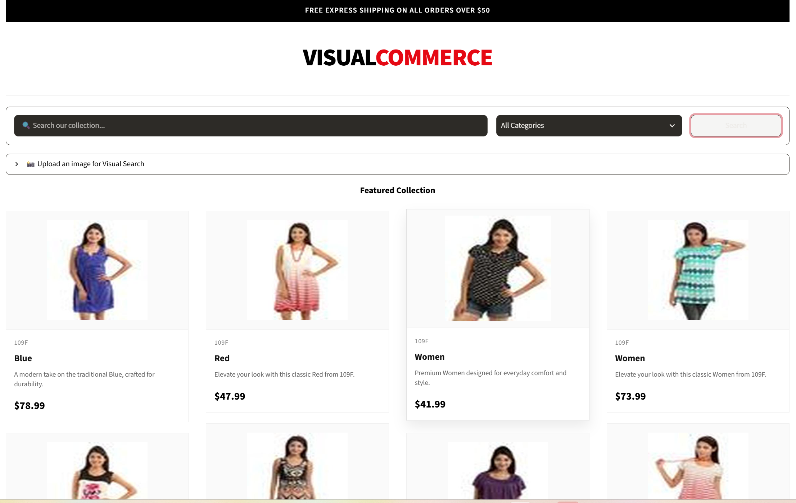

# 🛍️ VisualCommerce AI: Multimodal Visual Product Search

## 📌 Project Information
**Course:** Professional Training - YN3012170034 (Intermediate level)

**Project Type:** Mid-term Assignment

**Student Name:** FAHIM MD

**Student ID:** 20243120004

**Folder:** fah004

## 📖 Overview
VisualCommerce AI is an enterprise-grade, interactive Machine Learning application that performs **Multimodal Visual Product Search**. Unlike traditional e-commerce search engines that rely on manual text tags, this application allows users to search a catalog of 10,000 products using natural language (e.g., *"Red shoes"*, *"Blue dress"*) or by uploading an image (Reverse Image Search).

The system uses OpenAI's **CLIP (Contrastive Language-Image Pretraining)** model to project both images and text into the same 512-dimensional vector space, allowing for highly accurate semantic retrieval using Cosine Similarity.

## ✨ Key Features
*   **Text-to-Image Search:** Search for products using natural language.
*   **Image-to-Image Search:** Upload an image to find visually similar items in the catalog.
*   **Dynamic Category Filtering:** Filter results by product category (e.g., Shoes, Dresses, Bags).
*   **Pagination:** Efficiently browse through large datasets (10,000 images) without crashing the browser.
*   **Premium UI:** Custom CSS designed to mimic a high-end e-commerce boutique (similar to ASOS or Zara).

## 🏗️ Architecture & Tech Stack
*   **Machine Learning Model:** `clip-ViT-B-32` (via `sentence-transformers`)
*   **Framework:** Streamlit (Python)
*   **Vector Similarity:** PyTorch & Cosine Similarity (`util.cos_sim`)
*   **Image Processing:** Pillow (PIL)

## 📂 Project Structure
```text
fah004/
│
├── dataset/
│   └── images/            <-- (Generated by download_data.py)
│
├── inference/
│   └── visual_engine.py   <-- Core ML Engine (Embeddings & Search)
│
├── config.py              <-- Paths and Model configuration
├── main.py                <-- Streamlit User Interface
├── download_data.py       <-- Script to fetch the dataset
├── requirements.txt       <-- Dependencies
└── README.md              <-- Project documentation
```

## 🚀 Installation & Setup
**1. Clone the repository and navigate to the folder:**
```
git clone https://github.com/Fahim-web789/PT22026.git
cd PT22026/fah004
```
**2. Create and activate a virtual environment (Recommended):**
```
python -m venv venv
# On Windows:
venv\Scripts\activate
# On Mac/Linux:
source venv/bin/activate
```
**3. Install dependencies:**
```
pip install -r requirements.txt
```
**4. Download the Dataset:**
Run the automated script to download 10,000 fashion images from Hugging Face.
```
python download_data.py
```
## 💻 Usage
**To launch the interactive web application, run:**
```
streamlit run main.py
```
## How to Demo:
**Home Page:** Browse the "Featured Collection" or use the dropdown at the top to filter by category.

**Text Search:** Type "Red shoes" into the search bar and click Search.

**Reverse Image Search:** Click the 📷 camera icon, upload a picture of a clothing item, and the AI will find visually similar products.

**Pagination:** Click "Next Page" at the bottom to browse through the results.

## ⚠️ Limitations
**Dataset Quality:** The model's retrieval accuracy is highly dependent on the quality of the images. Low-resolution images (like those in the fashion-product-images-small dataset) may yield lower confidence scores.

**Abstract Concepts:** While CLIP is excellent at matching colors and shapes, it may struggle with highly abstract queries.

**Fine-tuning:** The model was used as a "Frozen Pre-trained Encoder" (Transfer Learning). Fine-tuning could yield higher accuracy but requires significant GPU resources.

## 📚 References
Radford, A., et al. (2021). Learning Transferable Visual Models From Natural Language Supervision. OpenAI.

Hugging Face Sentence-Transformers Documentation.

Dataset: ashraq/fashion-product-images-small (Hugging Face Hub).