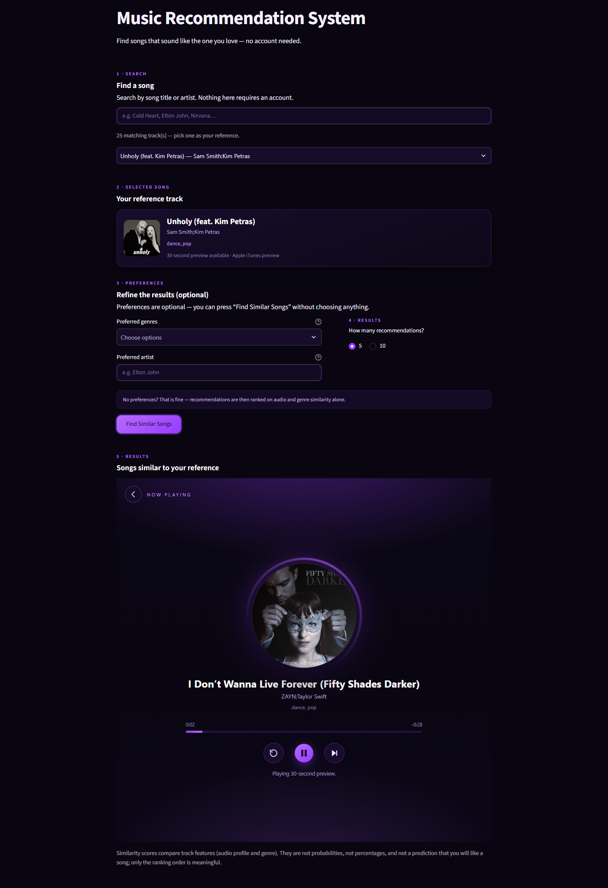
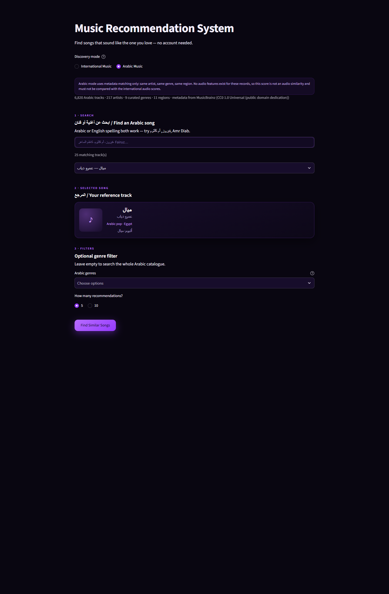

# Music Recommendation System

A content-based music recommender with **thirty-second audio previews**, built
with Python and Streamlit. Search for a song, optionally add genre or artist
preferences, and explore tracks that are close to it in sound.

Built as an individual university project (PT22026). No account, no login: the app
opens straight onto a single page.

> **Scores are cosine similarities, not probabilities.** They compare feature
> vectors; they do not predict whether you will like a song. The app says this
> wherever scores appear.

## Quick start

```powershell
# 1. Python 3.12 environment
python -m venv .venv
.venv\Scripts\python.exe -m pip install -r requirements.txt

# 2. Dataset (≈8.2 MB, never committed to Git)
curl.exe -L -o data/spotify-tracks-dataset.zip "https://www.kaggle.com/api/v1/datasets/download/maharshipandya/-spotify-tracks-dataset"
Expand-Archive data/spotify-tracks-dataset.zip -DestinationPath data

# 3. Run
.venv\Scripts\python.exe -m streamlit run app.py
```

Open the URL Streamlit prints (default `http://localhost:8501`).

Use `python -m streamlit`, **not** the `streamlit.exe` launcher: Windows Smart App
Control blocks that executable on this machine.

## The page

Everything happens on one page, top to bottom:

| Section | What you see |
|---|---|
| **Header** | "Music Recommendation System" and a one-line welcome. |
| **1 · Search** | Search by song title or artist; a dropdown of matching tracks. |
| **2 · Selected song** | Title, artists, genres, and album artwork **only when a legitimate source provides it** (Apple's official artwork for the matched track), plus a **player for the song's own 30-second preview** when one is verified. Otherwise a neutral note. |
| **3 · Preferences** *(optional)* | Preferred genres and artist. Clearly marked optional — you can skip it entirely. |
| **4 · Results** | Choose 5 or 10 recommendations. |
| **Find Similar Songs** | One primary button that produces the list. |
| **5 · Results** | Cards with rank, artwork, title, artists, genres, raw similarity score, the engine's explanation, and a **Play preview** button. |

There is no sidebar, no navigation and no login screen. The visual theme is dark
violet (`#090611` background, `#963BFF` accent, `#B66BFF` glow).

### More by your preferred artist

If you type an artist under **Preferences**, a second list appears below the
results: **"More by <artist> — closest in sound to your song"**. It shows up to
five of that artist's own tracks, ordered by similarity to your reference, each
with a preview button. The main ranking is not changed by this list: the
preference there stays a bounded 0.20 nudge, so the evaluated results remain
reproducible.

If you change the song or your preferences after pressing **Find Similar
Songs**, the old list is hidden and the app asks you to press the button again,
so results never appear under the wrong song.

### Now Playing



Clicking **Play preview** opens an expanded Now Playing view inside the results
area:

* back control and a **NOW PLAYING** label;
* large **circular artwork** with a glowing violet ring — only Apple's verified
  artwork, never a generated cover;
* track title, artist and genres;
* a progress bar showing **elapsed and remaining** time of the actual preview
  (capped at 30 s);
* play/pause, a **circular replay icon** (no "Replay" text), and next;
* a clear status line ("Playing 30-second preview.", "Paused.", "Replaying from
  the beginning.", "Preview finished…").

Closing it returns to the recommendations **without stopping playback or losing
the selected song** — the compact bar keeps the track and its controls, and
reopening restores the full view. Only one preview can play at a time: a single
`Audio` object drives everything, and at most one card is highlighted.

## Arabic music page

Besides the Spotify catalogue, the app has an **Arabic music** page (search and
recommendations over Arabic and Yemeni artists, with previews where Apple has them).



* **Data:** `data/arabic_catalogue.csv` (6,910 tracks, 36 artists) plus the Yemeni
  files `data/arabic_catalogue_yemeni*.csv`, built from **MusicBrainz** metadata
  (CC0 1.0). Region and genre labels are editorial choices of this project.
* **Included in the repository:** these files are small and CC0, so they are
  committed and the page works straight after cloning. Provenance is recorded in
  the matching `*_provenance.json` files.
* **Rebuilding (optional, slow):** `scripts/fetch_arabic_metadata.py`,
  `scripts/fetch_aliases_and_yemeni.py` and `scripts/build_corrected_yemeni.py`
  re-download the metadata from MusicBrainz.

## Audio previews

* **Provider:** the public **iTunes Search API** — no API key, no OAuth, no
  account.
* **Content:** Apple's official ~30-second AAC previews, **streamed** from Apple's
  CDN in your browser. Nothing is downloaded into this repository, and no audio is
  redistributed.
* **Verified on this machine:** the API returns a real `m4a` (`audio/x-m4p`,
  1,016,056 bytes) served from `audio-ssl.itunes.apple.com`.
* **Matching is strict:** a preview is shown only when the returned artist and
  title verifiably match the dataset track. Cover/tribute acts are rejected.
* **When no preview exists:** the card says **"Preview unavailable"** and offers a
  legitimate "Listen on Apple Music" search link. Nothing is faked.
* **Player capabilities:** the Now Playing view provides Play, Pause, Resume,
  **Replay from the beginning** (circular icon), Next preview, automatic stop at
  the end of the 30-second preview, a progress bar with elapsed/remaining time,
  and one highlighted "now playing" track. A single `Audio` object is used, so
  only one preview can play at a time.
* **Deployment note:** the app needs outbound HTTPS to `itunes.apple.com` for
  previews. Without it, the interface still works and every card shows
  "Preview unavailable". Set `MRS_DISABLE_PREVIEWS=1` to skip preview lookups
  entirely (used by the tests).

## How recommendations are computed

Unchanged from the evaluated engine:

1. **Catalogue** — 114,000 rows → 89,583 unique tracks (duplicate rows collapsed;
   1 junk row and 157 tracks with absent audio analysis excluded).
2. **Features** — nine standardised audio features plus a 114-dimension
   multi-label genre vector.
3. **Similarity** — `base = 0.90 × S_audio + 0.10 × S_genre` (cosine).
4. **Preferences** — `final = 0.80 × base + 0.20 × preference_score` when you
   choose genres/artists; with no preferences the ranking is pure similarity.
5. **Duplicate suppression** — the same recording under different ids appears
   once; variants with different audio or duration stay separate.
6. **Explanations** — shared genres, the two audio features contributing most, and
   any matched preference.

The similarity formula, duplicate rules and preprocessing are untouched by the
interface: `app.py` only calls `Recommender`.

## Project structure

```text
.
├── app.py                     # single-page Streamlit interface (presentation only)
├── previews.py                # official 30 s preview resolver (iTunes Search API)
├── recommender.py             # similarity, ranking, preferences, explanations
├── preprocessing.py           # loading, cleaning, de-duplication, feature matrix
├── evaluation.py              # reproducible evaluation → report/
├── .streamlit/config.toml     # light theme, minimal toolbar
├── assets/                    # UI screenshots
├── data/                      # Spotify dataset (git-ignored) + Arabic catalogue (committed)
├── docs/                      # dataset, design, evaluation, testing notes
├── report/                    # generated evaluation results
├── analysis/                  # weight study and sample scripts
├── tests/                     # pytest suite
├── requirements.txt
└── tasks.md                   # plan and progress log
```

## Testing

```powershell
.venv\Scripts\python.exe -m pytest tests -q
```

The suite covers preprocessing, the recommender, evaluation, integration, the
preview matcher and the UI flow (through Streamlit's `AppTest`, with previews
disabled so no network is used).

## Evaluation

```powershell
.venv\Scripts\python.exe evaluation.py
```

Writes `report/evaluation_results.md` and `.csv`. **No accuracy, precision, recall
or NDCG is reported** — the dataset has no relevance labels, so those cannot be
computed honestly. See `docs/evaluation.md`.

## Dataset and licence

"Spotify Tracks Dataset" by **MaharshiPandya**, obtained from Kaggle on
2026-11-18: <https://www.kaggle.com/datasets/maharshipandya/-spotify-tracks-dataset>

Database licensed under the **Open Database License (ODbL) v1.0**; copyright in
the contents remains with the original authors. The dataset is **not
redistributed** here — `data/*.csv` and `data/*.zip` are git-ignored. Evidence:
`docs/dataset-license-evidence.md`.

Preview audio is © Apple Inc. / the respective rights holders, streamed from
Apple's public preview service for promotional listening; it is not stored or
redistributed by this project.

## Limitations

- No user data: no collaborative filtering, no learnt taste, no history.
- Preference weighting is a bounded nudge (0.20), not personalization learning.
- 157 tracks with absent audio analysis cannot be recommended.
- Content-based neighbours are inherently low-diversity.
- Popularity bias is not corrected for.
- Identical-looking recordings whose stored audio differs can appear twice.
- Previews depend on Apple's catalogue and network access; some tracks genuinely
  have none, and the match is intentionally strict.
- Scores are uncalibrated: only the ordering is meaningful.

## Troubleshooting

| Symptom | Fix |
|---|---|
| `Program 'streamlit.exe' failed to run: An Application Control policy has blocked this file` | Use `python -m streamlit run app.py`. |
| `Dataset CSV not found at: …` | Complete step 2 of the quick start. |
| Cards all say "Preview unavailable" | No network access to `itunes.apple.com`, or the track has no official preview. |
| `ModuleNotFoundError` | Install dependencies into the venv (step 1). |
| `No Python at '...\Python312\python.exe'` after copying the project to another computer | Virtual environments are not portable. Create a new one there: `python -m venv venv`, then `venv\Scripts\python.exe -m pip install -r requirements.txt`. |
| Streamlit asks for an e-mail address on the first run | Leave it empty and press Enter. |
| `Please replace st.components.v1.html with st.iframe` in the terminal | A deprecation warning only; the pinned Streamlit 1.67 still supports it, so the player works. |
| The progress bar moves but nothing is heard | Check the system volume and that the browser tab is not muted ("Unmute site"). |

## Acknowledgements

Audio features come from the dataset author (derived from Spotify audio analysis).
Preview audio is provided by Apple's public iTunes Search API. Built with pandas,
NumPy, scikit-learn, SciPy and Streamlit.
