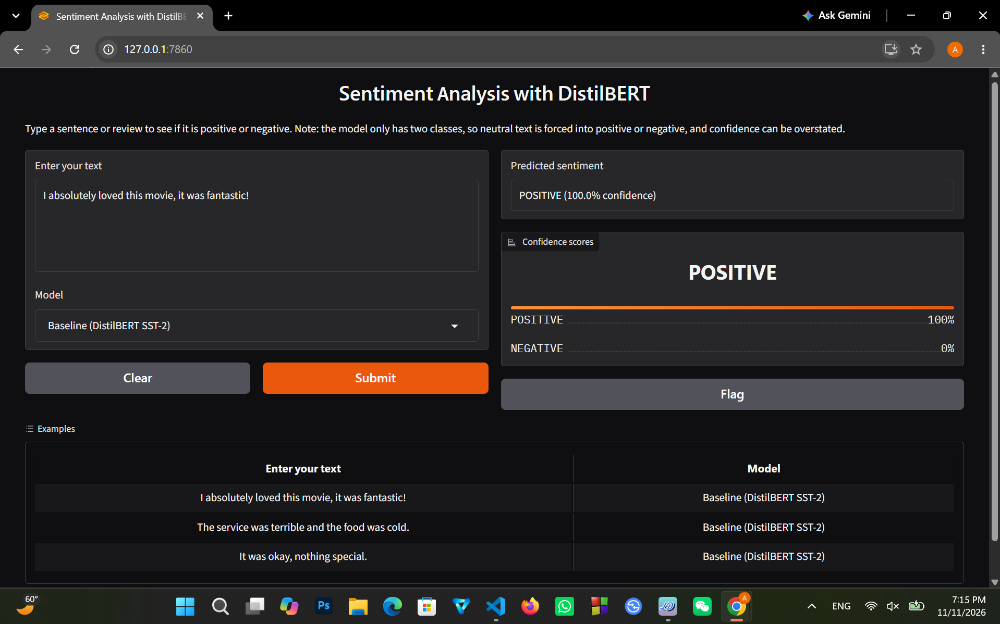
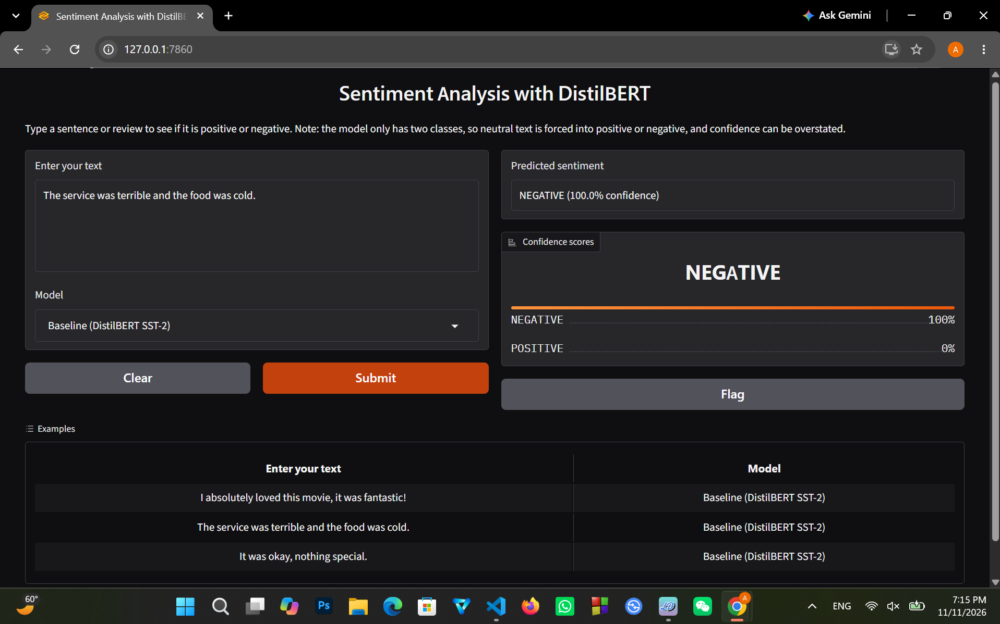
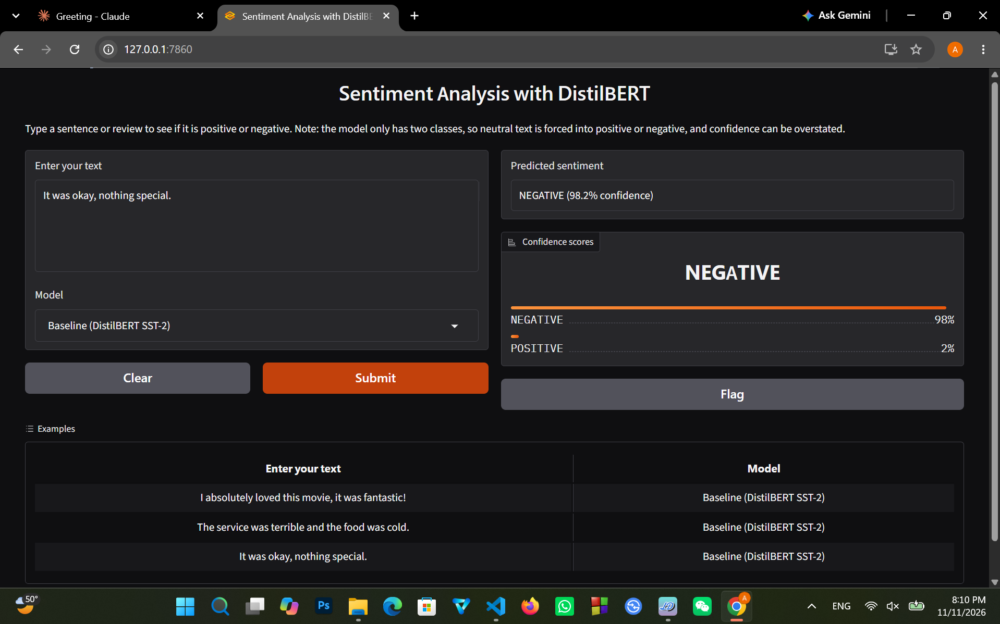
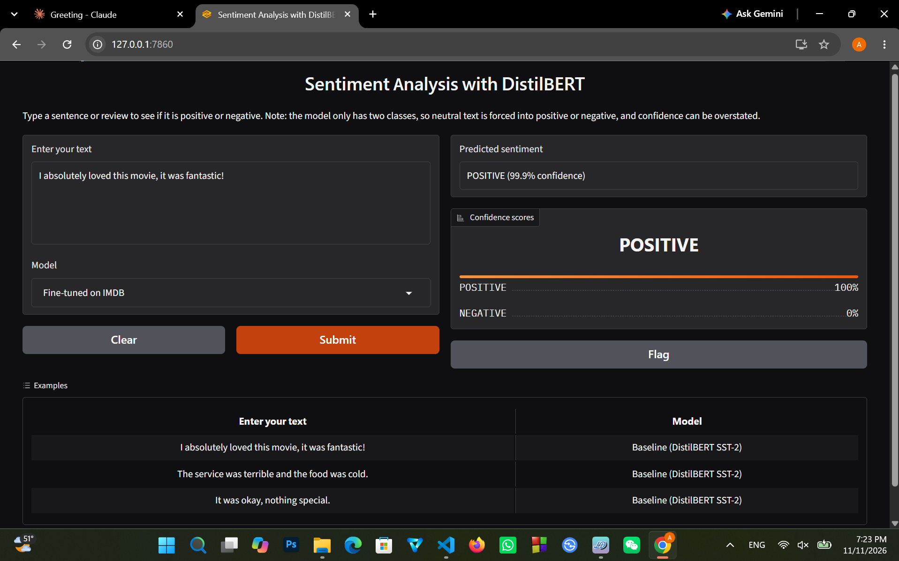

# Sentiment Analysis App (DistilBERT + Gradio)

Mid-term project for Professional Training (YN3012170034).
Author: Haidari Ali Hussain (folder `hai087`).

An interactive web app that classifies English text as **positive** or
**negative**. It uses a Transformer model (DistilBERT) and lets the user
compare a pre-trained baseline with a version fine-tuned on IMDB movie reviews.

## Features

- Text box for any English sentence or review.
- Prediction (POSITIVE / NEGATIVE) with a confidence score and chart.
- Model selector: baseline (DistilBERT SST-2) or fine-tuned on IMDB.
- Input validation: empty text, over-long text (2000 characters) and
  missing models are handled with clear messages.
- Evaluation script (accuracy, precision, recall, F1, confusion matrix).
- Training script for fine-tuning.

## Models

| Model | Source | Used for |
|---|---|---|
| Baseline | `distilbert-base-uncased-finetuned-sst-2-english` (Hugging Face Hub) | Pre-trained on SST-2, used as is |
| Fine-tuned | Baseline further trained on IMDB reviews (`train.py`) | Compared against the baseline |

DistilBERT is a smaller, faster version of BERT. It is a Transformer
encoder that uses self-attention to build a representation of the whole
sentence. A classification layer on top turns that representation into
POSITIVE / NEGATIVE probabilities.

## Project structure

```
hai087/
├── app.py              # Gradio web app
├── evaluate.py         # evaluation on IMDB test reviews
├── train.py            # fine-tuning script
├── requirements.txt    # Python dependencies
├── eval_results/       # metrics (JSON) and confusion matrices (PNG)
├── .gitignore
└── README.md
```

Large files (the `venv` folder and the saved model in `models/`) are not
uploaded to GitHub.

## Datasets

No dataset is stored in this repository. The scripts download them automatically from the Hugging Face Hub with the `datasets` library.

| Dataset | Source | Used for |
|---|---|---|
| IMDB (`stanfordnlp/imdb`) | https://huggingface.co/datasets/stanfordnlp/imdb | 2,000 random training reviews for fine-tuning (`train.py`) and 500 random test reviews for evaluation (`evaluate.py`), both with random seed 42 |

The baseline model (`distilbert-base-uncased-finetuned-sst-2-english`) is downloaded automatically from the Hugging Face Hub the first time the app runs. It was already fine-tuned on SST-2 by its authors. The fine-tuned model is not included in the repository because of its size: create it with `python train.py` (about 25 minutes on a CPU).
## Installation (Windows, PowerShell)

1. Install Python 3.11 and Git.
2. Clone the repository and open the project folder:

```
git clone https://github.com/xahiru/PT22026.git
cd PT22026\hai087
```

3. Create and activate a virtual environment:

```
python -m venv venv
venv\Scripts\activate
```

4. Install the dependencies:

```
pip install -r requirements.txt
```

## Usage

Run the app:

```
python app.py
```

Open `http://127.0.0.1:7860` in a browser, type a text, choose a model and
press Submit.

If you get a `502` error when the app starts (this happened with a proxy or
VPN), run this before `python app.py`:

```
$env:NO_PROXY = "127.0.0.1,localhost"
```

The first run downloads the baseline model (about 250 MB).

### Train the fine-tuned model (optional)

```
python train.py
```

This creates `models/finetuned-imdb`. After that, the app shows the
"Fine-tuned on IMDB" option. Training took about 25 minutes on a CPU.

### Evaluate a model

```
python evaluate.py
python evaluate.py models/finetuned-imdb finetuned
```

Results are saved in `eval_results/`.

## Training and evaluation setup

| Item | Value |
|---|---|
| Fine-tuning data | 2,000 random IMDB training reviews |
| Epochs | 1 |
| Learning rate | 2e-5 |
| Batch size | 16 |
| Max length | 256 tokens |
| Final training loss | 0.357 |
| Training time | 24.5 minutes (CPU) |
| Evaluation data | 500 random IMDB test reviews (seed 42), max length 256 |

## Results

| Metric | Baseline | Fine-tuned |
|---|---|---|
| Accuracy | 87.6% | 87.2% |
| Precision | 88.98% | 84.73% |
| Recall | 85.37% | 90.24% |
| F1 score | 87.14% | 87.40% |

Confusion matrices (rows = actual, columns = predicted):

| | Baseline: neg | Baseline: pos | Fine-tuned: neg | Fine-tuned: pos |
|---|---|---|---|---|
| Actual negative | 228 | 26 | 214 | 40 |
| Actual positive | 36 | 210 | 24 | 222 |

Fine-tuning for one epoch on 2,000 reviews did not change overall accuracy
in a meaningful way (with 500 test reviews the difference is within the
margin of error), but it shifted the balance: the fine-tuned model finds more
positive reviews (higher recall) and makes more false positives (lower
precision). The images are in `eval_results/`.

## Screenshots

| Baseline, positive | Baseline, negative |
|---|---|
|  |  |

| Baseline, neutral text (forced to negative) | Fine-tuned model, positive |
|---|---|
|  |  |

## Limitations

- Only two classes: neutral text is forced into positive or negative
  (for example, "It was okay, nothing special." is predicted NEGATIVE).
- Confidence can be overstated: very short or ambiguous text may get 100%.
- Predictions are sensitive to wording (removing "nothing special" flipped
  one prediction).
- English only; sarcasm and context are hard for the model.
- The baseline was trained on short SST-2 sentences, so long reviews are a
  domain shift. Long inputs are truncated to the model's token limit.
- Evaluation used only 500 reviews, so the results have a margin of error
  of a few percentage points.

## References

- Sanh, V., Debut, L., Chaumond, J., Wolf, T. (2019). DistilBERT, a
  distilled version of BERT: smaller, faster, cheaper and lighter.
- Socher, R. et al. (2013). Recursive Deep Models for Semantic
  Compositionality Over a Sentiment Treebank (SST-2).
- Maas, A. et al. (2011). Learning Word Vectors for Sentiment Analysis (IMDB).
- Wolf, T. et al. (2020). Transformers: State-of-the-Art Natural Language
  Processing. Hugging Face.
- Abid, A. et al. (2019). Gradio: Hassle-Free Sharing and Testing of ML Models.
- Model card: `distilbert-base-uncased-finetuned-sst-2-english`, Hugging Face Hub.