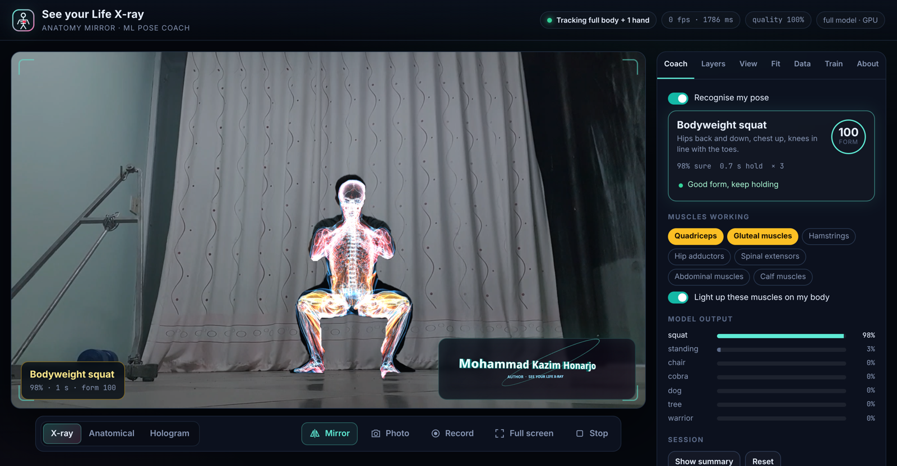

# See your Life X-ray

An interactive machine learning application that recognises body poses from a webcam, scores the form, counts repetitions and shows the working muscles inside a 3D anatomy model drawn on the user's body.

Author: Mohammad Kazim Honarjo, Student ID 20243120085
Course: Professional Training (YN3012170034), School of Software, Yunnan University



## The problem

People who practise yoga or bodyweight exercises at home have no trainer to tell them whether a pose is right, and most do not know which muscles a pose works. This app gives that feedback with a normal webcam:

- it names the pose (standing, squat, chair, tree, warrior III, cobra, downward dog),
- it gives a form score and up to two corrections,
- it counts repetitions and hold time,
- it lights up the working muscle groups in a 3D anatomy overlay that follows the body,
- it can learn a new pose from a few seconds of recording.

## How it works

```
webcam frame
   -> MediaPipe BlazePose (pre-trained)        33 body landmarks in 3D
   -> feature extraction (xray/features.py)    76 features, independent of size, position and view
   -> pose classifier (xray/classifier.py)     neural network trained for this project
   -> coach (xray/coach.py, xray/form.py)      stable label, hold time, repetitions, form rules, muscles
   -> web client (web/)                        3D anatomy, muscle glow, Coach and Train tabs
```

| Part | Technology |
|---|---|
| Server and API | Python, FastAPI, WebSocket |
| Machine learning | scikit-learn (MLP, logistic regression, SVM, random forest, k-NN), NumPy |
| Pose landmarks | MediaPipe Pose Landmarker (BlazePose), in Python for data and photos, in the browser for live video |
| Client | JavaScript, three.js, WebGL |

The camera picture stays in the browser. Only the 33 landmarks of each frame are sent to the Python server, about 12 times per second.

## Results

Trained on 1,634 poses of 21 subjects, tested once on 661 poses of 5 subjects that were never used for training or model selection.

| Measure | Value |
|---|---|
| Test accuracy | 94.6 % |
| Test macro F1 | 0.945 |
| Validation accuracy, leave one subject out, 21 folds | 90.7 % |
| Prediction time | 0.36 ms per pose |

Full results, the comparison of five algorithms and four feature sets, robustness tests and limitations are in [docs/MODEL.md](docs/MODEL.md). The numbers come from `reports/metrics.json`, written by `scripts/evaluate.py`.

## Installation

Requires Python 3.10 or newer and Chrome or Edge.

```
pip install -r requirements.txt
python scripts/fetch_assets.py
python run.py
```

`fetch_assets.py` downloads the MediaPipe model files (52 MB) and the two JavaScript libraries (20 MB), which are not stored in the repository. `run.py` starts the server and opens `http://localhost:8000`.

On Windows, double-clicking `Start See your Life X-ray.bat` does the same three steps.

With Docker (also the layout a Hugging Face Docker Space expects, port 7860):

```
docker build -t see-your-life-xray .
docker run -p 7860:7860 see-your-life-xray
```

## Usage

1. Press **Start camera** and step back until the whole body is visible.
2. The **Coach** tab shows the recognised pose, confidence, hold time, repetitions, form score, hints and muscles.
3. **Analyse a photo** in the Coach tab sends a picture to `POST /api/analyze`.
4. The **Train** tab shows the current model, records new poses and retrains.

## Reproducing the model

```
python scripts/download_data.py        # about 250 MB of public images and videos into data/raw
python scripts/extract_landmarks.py    # BlazePose Heavy on every image and frame, about 10 minutes on a CPU
python scripts/train.py                # trains and validates, writes models/pose_classifier.joblib
python scripts/evaluate.py --tune      # all experiments, writes reports/
python -m pytest tests                 # 38 tests
```

`scripts/train.py --algorithm {mlp,logreg,svm,forest,knn}` and `--features {raw,normalized,aligned,full}` select other configurations.

## Data

| Source | Content | Use | Licence |
|---|---|---|---|
| Yoga poses, TensorFlow pose classification tutorial | 1,495 rendered images, 5 poses, 7 characters, many camera angles | chair, cobra, dog, tree, warrior | Apache 2.0 |
| Dual-View Squat Movement Dataset (nihar787airobotics/squat_dataset_publication) | front and side videos of 20 adults doing squats | standing, squat | not final; used for coursework, not redistributed |

The raw images and videos are not in the repository. The landmark table derived from them (`data/pose_landmarks.csv`, 2,295 rows, 2.5 MB of text) and the trained classifier (0.6 MB) are included so that the app runs without the extraction step.

## Project layout

```
xray/                 Python package
  features.py           landmark normalisation, joint angles, distances
  pose_estimator.py     MediaPipe wrapper for still images
  dataset.py            landmark tables (CSV)
  training.py           algorithms, augmentation, subject-wise validation
  classifier.py         PoseClassifier: fit, predict, save, load
  trainer.py            builds the training table and trains
  coach.py              temporal smoothing, hold time, repetitions
  form.py               form rules and score
  muscles.py            muscle groups and the pose-to-muscle map
  samples.py            poses recorded by the user
  server.py             FastAPI application
scripts/              data download, extraction, training, evaluation, asset download
tests/                pytest suite
web/                  browser client (HTML, CSS, JavaScript, anatomy meshes)
data/                 landmark table; raw data is downloaded here
models/               trained classifier
reports/              metrics.json and figures
docs/                 model documentation and demo plan
```

## API

| Method | Path | Purpose |
|---|---|---|
| GET | `/api/health` | server status |
| GET | `/api/model` | classes, training information, evaluation summary |
| POST | `/api/analyze` | pose, angles and muscles for an uploaded picture |
| GET, POST | `/api/samples` | list or add recorded poses |
| DELETE | `/api/samples/{label}` | remove the recorded samples of one pose |
| POST | `/api/train` | retrain with the chosen algorithm |
| WebSocket | `/ws/coach` | live coaching, one message per frame |

Interactive API documentation is served at `/docs` while the app runs.

## Limitations

- The classifier knows seven poses. A movement outside them is usually given the nearest known label; a lunge is read as standing or tree.
- The yoga training images are computer renders, not photographs of people.
- Warrior III seen from above is often missed because the landmarks themselves are wrong in that view.
- Form feedback uses simple angle limits and is not a substitute for a trainer.
- The anatomy is an average adult model scaled to the user, not a scan. This is an educational tool, not a medical device.

## Credits

Anatomy meshes: BodyParts3D, © The Database Center for Life Science, CC BY-SA 2.1 Japan. All third-party components and references are listed in [LICENSES.md](LICENSES.md).
