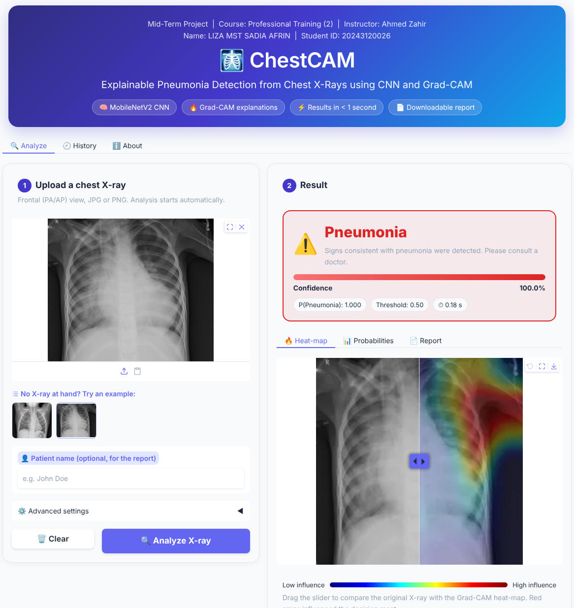
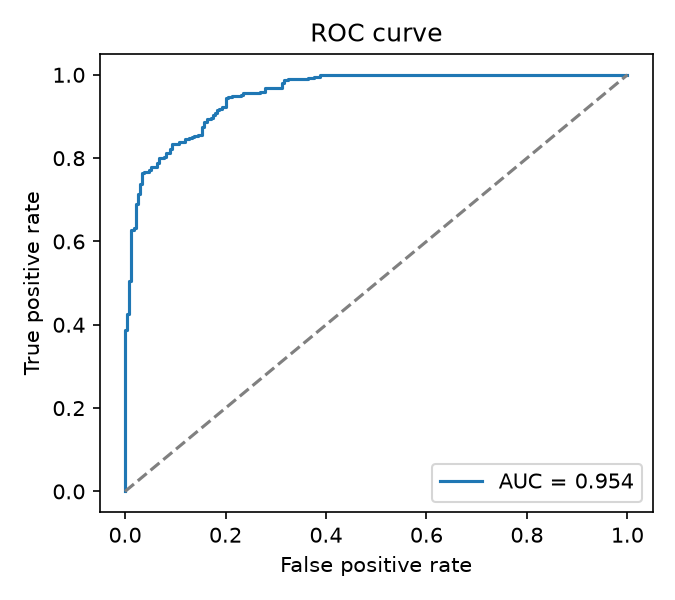
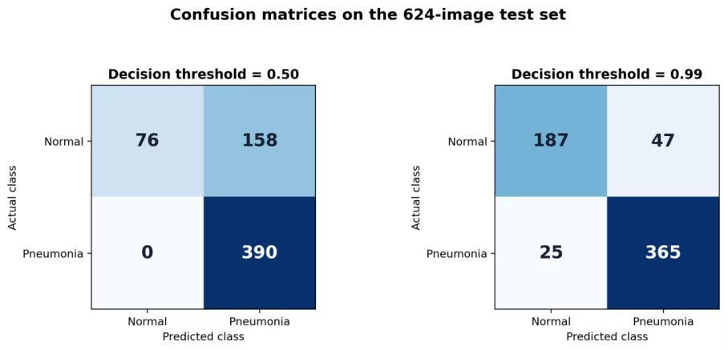

# 🩻 ChestCAM — Explainable Pneumonia Detection from Chest X-Rays using CNN and Grad-CAM

| | |
|---|---|
| **Course** | Professional Training (2) — Mid-Term Project |
| **Instructor** | Ahmed Zahir |
| **Student** | LIZA MST SADIA AFRIN |
| **Student ID** | 20243120026 |

ChestCAM is an interactive web app that classifies a frontal chest X-ray as **Normal** or
**Pneumonia** using a MobileNetV2 convolutional neural network (CNN). It also shows *why* it
made that decision with a **Grad-CAM heat-map** that highlights the regions of the X-ray that
influenced the prediction most.

> ⚠️ **Educational use only.** ChestCAM is not a medical device and must not be used for diagnosis.



---

## 1. Problem

Pneumonia is a leading cause of death in children under five. Chest radiography is the
standard diagnostic tool, but reading X-rays needs trained radiologists, who are scarce in many
regions. A CNN can act as a fast second opinion, but a bare "Pneumonia: 97%" is hard to trust.
ChestCAM adds a visual explanation so the user can check *where* the network looked before
trusting the result.

## 2. Features

### Using the app
| Step | What happens |
|---|---|
| **1 · Upload** | Drag and drop, browse, or paste a chest X-ray (JPG/PNG), or click one of the example images. **Analysis starts automatically**; no button press needed. |
| **2 · Result** | A color-coded result card: green ✅ **Normal** or red ⚠️ **Pneumonia**, a confidence bar, P(Pneumonia), the threshold used, and the processing time. |
| **🔥 Heat-map tab** | An interactive **before/after slider**: drag the handle to compare the original X-ray with the Grad-CAM overlay. A color legend explains low → high influence. |
| **📊 Probabilities tab** | Probability bars for both classes. |
| **📄 Report tab** | Download a self-contained **HTML report** with the X-ray, heat-map, result and disclaimer (open in any browser or print to PDF). |
| **🕘 History tab** | A table of every X-ray analyzed in the session, with a *Clear history* button. |
| **ℹ️ About tab** | Model architecture, how Grad-CAM works, what the threshold means, and limitations. |

### Extra controls and safety checks
* **⚙️ Advanced settings → Decision threshold slider** (0.05–0.99, steps of 0.01). Lower it to catch more
  pneumonia cases (higher sensitivity); raise it to reduce false alarms (higher specificity).
  The result updates as soon as you release the slider.
* **Input validation:** images smaller than 64 × 64 are rejected. Warnings are shown for
  color photos (probably not an X-ray), unusual aspect ratios, scores close to the decision
  threshold (0.35–0.65 at the default 0.5), and cases where a high or low threshold overrides
  the way the model is leaning.
* **16-bit images:** 16-bit grayscale PNGs (common for raw X-ray exports) are rescaled to 8-bit
  before analysis instead of being clipped to white.
* **Patient name** (optional) is printed on the report.
* **Clear** button resets the whole page.

### Interface design
* Gradient header with the course and student details.
* Numbered two-card layout (input left, results right) so the workflow is obvious.
* Secondary information is kept in tabs and accordions to avoid clutter.
* Soft indigo theme with rounded cards; works in light and dark mode.

## 3. Inspiration and what is new

ChestCAM builds on the open-source project
[Youssefx64/Xray-Analysis-using-CNN-and-gradio-deployment](https://github.com/Youssefx64/Xray-Analysis-using-CNN-and-gradio-deployment)
and **reuses its pretrained model weights**. All application code was rewritten from scratch.

| Feature | Original project | ChestCAM |
|---|---|---|
| Prediction (Normal / Pneumonia) | ✅ | ✅ |
| Explainability | ❌ | ✅ Grad-CAM with before/after slider |
| How results are shown | raw JSON text | color-coded result card + confidence bar + probability chart |
| Starting an analysis | button only | automatic on upload / example / threshold change |
| Decision threshold | fixed 0.5 | adjustable slider |
| Input validation and warnings | ❌ | ✅ |
| Report | plain `.txt` | HTML report with X-ray + heat-map embedded |
| Session history, example images, About tab | ❌ | ✅ |
| Code structure | single script | modular package (`src/`) |
| Evaluation script (accuracy, precision, recall, F1, ROC-AUC, confusion matrix) | ❌ | ✅ `scripts/evaluate.py` |
| Model weights in Git | committed (13 MB) | downloaded automatically on first run |
| Runs without TensorFlow | ❌ (needs TensorFlow) | ✅ Keras 3 on the PyTorch backend |

## 4. Model

* **Architecture:** MobileNetV2 backbone (ImageNet-pretrained, frozen) →
  GlobalAveragePooling2D → BatchNormalization → Dropout(0.45) → Dense(ReLU) → Dropout(0.25)
  → Dense(ReLU) → Dense(1, sigmoid). About 2.56 million parameters in total.
* **Input:** 224 × 224 × 3 RGB image, pixel values scaled to [0, 1].
* **Output:** P(Pneumonia) between 0 and 1. The label is *Pneumonia* if P ≥ threshold
  (default 0.5).
* **Framework:** Keras 3 running on the **PyTorch** backend. TensorFlow is not needed
  (a TensorFlow code path is kept for anyone who prefers it); the same `.keras` weights load unchanged.
* **Training data:** [Chest X-Ray Images (Pneumonia)](https://www.kaggle.com/datasets/paultimothymooney/chest-xray-pneumonia)
  (Kermany et al., 2018): 5,856 pediatric chest X-rays (ages 1–5) from Guangzhou Women and
  Children's Medical Center. Training notebook by the original author:
  [Kaggle – Chest-Xray-Vision-98](https://www.kaggle.com/code/yousseftaha98/chest-xray-vision-98).

### How Grad-CAM works here
1. The X-ray passes through MobileNetV2; the last convolutional layer (`out_relu`) produces
   1,280 feature maps of size 7 × 7.
2. The gradient of the **pre-sigmoid logit** with respect to these maps is computed. (Using the
   logit instead of the probability keeps the map informative even when the model is 100 %
   confident, because the sigmoid's gradient vanishes there.)
3. Gradients are averaged per map to give one weight per channel; the weighted sum of the maps,
   passed through ReLU and normalized, gives a 7 × 7 relevance map.
4. The map is upsampled to the image size and blended over the X-ray with a jet color map
   (blue = low, red = high influence). For a *Normal* prediction the negative logit is
   explained, so the map always shows evidence for the predicted class.

### Limitations
* Trained on children's X-rays from one hospital, so performance on adults or other scanners is
  unknown.
* Only two classes: it cannot distinguish bacterial vs viral pneumonia, COVID-19, TB, etc.
* Grad-CAM often highlights shoulders, the neck or text markers, which suggests the model partly
  relies on non-lung cues ("shortcut learning"). Always inspect the heat-map.
* Grad-CAM resolution is coarse (a 7 × 7 grid).
* The input is resized to 224 × 224, which loses fine detail.

## 5. Project structure

```
liz026/
├── app.py                  # Gradio UI (layout, styling, callbacks) – run this
├── src/
│   ├── config.py           # paths, constants, Keras backend selection
│   ├── model_loader.py     # downloads + loads the pretrained model (cached)
│   ├── preprocessing.py    # input validation and 224x224 preprocessing
│   ├── gradcam.py          # Grad-CAM computation and heat-map overlay
│   ├── predictor.py        # full inference pipeline (validate → predict → explain)
│   └── report.py           # HTML report generation
├── scripts/
│   └── evaluate.py         # metrics on a labeled test set
├── examples/               # two sample X-rays (Normal, Pneumonia) from the Kaggle test set
├── docs/
│   └── screenshot.png      # screenshot used in this README
├── results/                # evaluation output on the Kaggle test set (see section 8)
├── model/                  # model file is downloaded here (git-ignored)
├── reports/                # generated HTML reports (git-ignored)
├── ChestCAM_Mid_Technical_Report.docx   # project report
├── ChestCAM_Presentation.pptx          # presentation slides
├── requirements.txt
└── .gitignore
```

## 6. Installation

Developed and tested on Python 3.12.

```bash
git clone https://github.com/xahiru/PT22026.git
cd PT22026/liz026
python -m venv .venv
# Windows: .venv\Scripts\activate     macOS/Linux: source .venv/bin/activate
pip install -r requirements.txt
```

**PyCharm:** open the project, select the `.venv` interpreter
(*Settings → Python Interpreter*), then open the **Terminal** tab and run
`pip install -r requirements.txt` inside the `liz026` folder.

### Model weights
The first run downloads `pneumonia_detection_Vision_Model.keras` (13 MB) into `model/`
automatically. If you are offline, download it manually from
<https://github.com/Youssefx64/Xray-Analysis-using-CNN-and-gradio-deployment/raw/main/models/pneumonia_detection_Vision_Model.keras>
and save it in `model/`.

## 7. Running the app

```bash
python app.py
```

The browser opens automatically at <http://127.0.0.1:7860>.

1. Drop a chest X-ray onto the upload box, or click an example image.
2. Read the result card on the right.
3. Open the **🔥 Heat-map** tab and drag the slider to compare the X-ray with the Grad-CAM map.
4. Optionally enter a patient name and download the report from the **📄 Report** tab.
5. Change the threshold under **⚙️ Advanced settings** to see how the decision changes.

**Troubleshooting**
* *Port 7860 already in use:* stop the previous run (red ■ Stop button in PyCharm) or change
  `SERVER_PORT` in `src/config.py`.
* *Old interface still showing:* stop the app, run it again, and hard-refresh the browser
  (Ctrl + F5).

## 8. Evaluating the model

Download the Kaggle dataset, then run:

```bash
python scripts/evaluate.py --data path/to/chest_xray/test
```

This writes the following to `results/`:
* `metrics.json`: accuracy, precision, recall (sensitivity), specificity, F1, ROC-AUC
* `threshold_sweep.csv`: the same metrics for thresholds 0.05 … 0.95, plus 0.98, 0.99, 0.995 and 0.999
* `predictions.csv`: per-image probability
* `confusion_matrix.png` and `roc_curve.png`

### Results on the Kaggle test set

The output of running the script on the official Kaggle test set (624 images: 234 Normal, 390 Pneumonia)
with Python 3.12 is committed in [`results/`](results/).

| Metric | Threshold 0.5 (default) | Threshold 0.99 |
|---|---|---|
| Accuracy | 74.7% | 88.5% |
| Precision | 71.2% | 88.6% |
| Recall (sensitivity) | 100% | 93.6% |
| Specificity | 32.5% | 79.9% |
| F1 | 0.832 | 0.910 |
| ROC-AUC | 0.954 | 0.954 |





The model ranks images well (ROC-AUC 0.954) and misses no pneumonia case at the default threshold, but it
labels 158 of the 234 normal X-rays as pneumonia. A threshold near 0.99 gives a much better balance. That
threshold was chosen by looking at the test set itself, so its figures are optimistic.

## 9. Technologies

Python · Keras 3 · PyTorch · Gradio 6 · NumPy · Pillow · Matplotlib (evaluation plots only)

## 10. References and acknowledgements

1. Kermany, D. S., et al. (2018). Identifying medical diagnoses and treatable diseases by
   image-based deep learning. *Cell*, 172(5), 1122–1131.
2. Sandler, M., et al. (2018). MobileNetV2: Inverted residuals and linear bottlenecks. *CVPR*.
3. Selvaraju, R. R., et al. (2017). Grad-CAM: Visual explanations from deep networks via
   gradient-based localization. *ICCV*.
4. Youssef Taha Badawi. *Xray-Analysis-using-CNN-and-gradio-deployment* (GitHub). Source of the
   pretrained model weights and the example images.
5. Gradio: <https://www.gradio.app> · Keras: <https://keras.io> · PyTorch: <https://pytorch.org>
