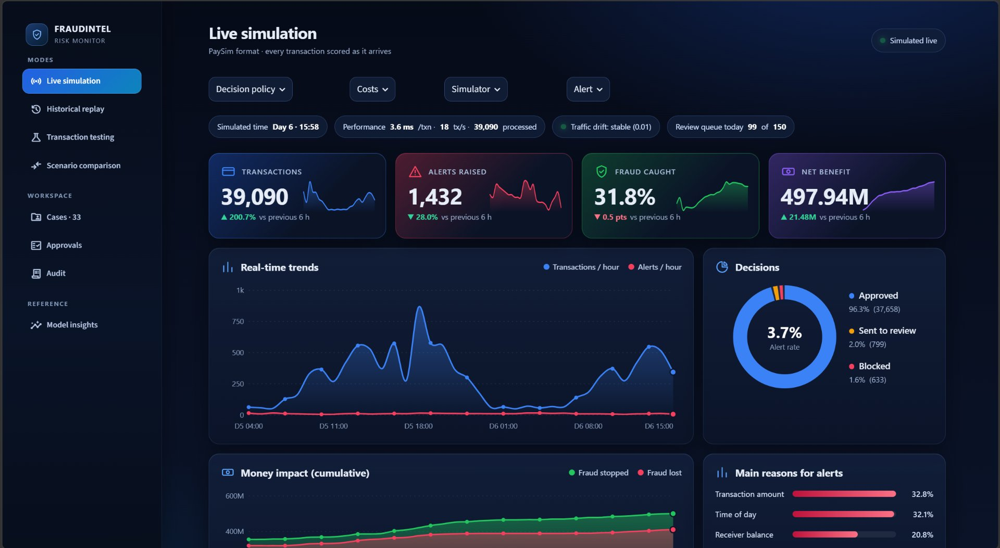
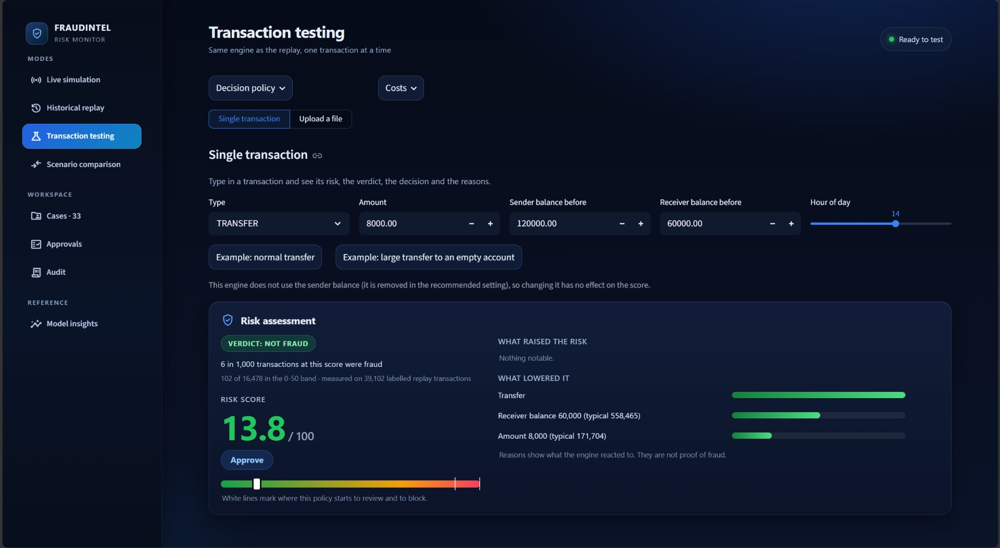
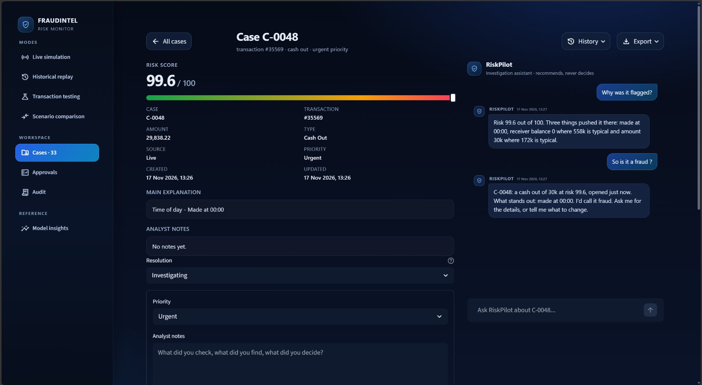
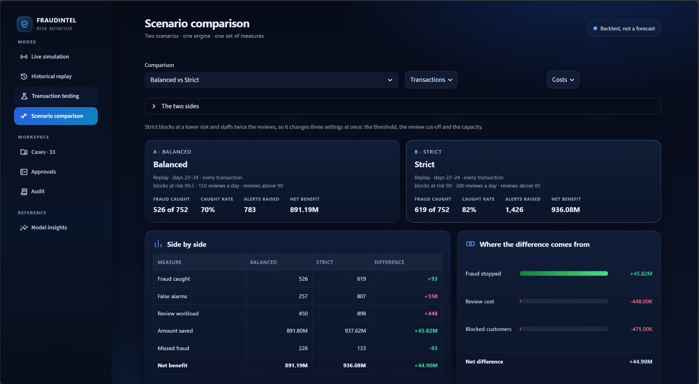

# FRAUDINTEL

A PaySim-based fraud detection and risk-management platform that scores mobile-money transactions, recommends approve/review/block decisions, and supports investigation workflows.

**Live demo:** [fraudintelai.streamlit.app](https://fraudintelai.streamlit.app/)

## Visual demo

<p align="center">
  
  
  <br />
  
  
</p>

## Features

- Three fraud detectors: Logistic Regression, XGBoost, and Isolation Forest.
- A stacked Risk Engine that converts model outputs into a 0–100 risk score.
- Deterministic policies for approve, review, and block decisions.
- Review-capacity limits, cost settings, policy presets, and policy recommendations.
- Historical replay of held-out PaySim transactions.
- Automatic live simulation with generated PaySim-format transactions.
- Single-transaction testing and CSV batch scoring.
- Risk explanations based on feature contributions.
- Drift monitoring and market-shift scenarios.
- Scenario comparison for policies, traffic, and fraud patterns.
- Model-insights page showing detector roles, metrics, weights, and limitations.
- Persistent investigation cases, notes, priorities, status, and history.
- Append-only decision audit log and assistant proposal queue.
- RiskPilot investigation assistant with human approval before case changes.
- PDF and CSV case reports.

This project currently supports PaySim mobile-money transactions.

## Installation

### Prerequisites

- Windows, macOS, or Linux
- Python 3.9 or newer
- A PaySim dataset CSV
- No GPU is required

Create an environment and install the dependencies:

```bash
python -m venv .venv

# Windows PowerShell
.venv\Scripts\Activate.ps1

# macOS/Linux
# source .venv/bin/activate

pip install -r requirements.txt
```

Download the PaySim dataset from [Kaggle](https://www.kaggle.com/datasets/ealaxi/paysim1), then place the CSV here:

```text
data/PS_20174392719_1491204439457_log.csv
```

The dataset is not included in this repository.

## Usage

### 1. Train the recommended models

From the project root:

```bash
python train/train.py \
  --data-path data/PS_20174392719_1491204439457_log.csv \
  --drop-features amount_to_balance oldbalanceOrg
```

This creates the trained models and replay artifacts under `models/` and `results/`.

### 2. Start the application

```bash
streamlit run app/app.py
```

On Windows, if Streamlit encounters a certificate-store problem:

```bash
python run_local.py
```

The application provides four operating modes:

- **Historical replay:** replay a held-out period hour by hour and compare policy outcomes.
- **Live simulation:** generate transactions continuously and score them as they arrive.
- **Transaction testing:** enter one transaction or upload a CSV file.
- **Scenario comparison:** compare two policies or traffic scenarios on the same measures.

The Reference section also includes Model insights. The workspace includes Cases, Audit, and Approvals pages. Cases and investigation history are stored in local SQLite files under `data/`.

### 3. Run tests

Fast tests:

```bash
python -m pytest -m "not slow" -q
```

Full test suite:

```bash
python -m pytest -q
```

### Optional training commands

Run an ablation or leakage experiment when needed:

```bash
python train/train.py --data-path data/PS_20174392719_1491204439457_log.csv --drop-features amount_to_balance
python train/train.py --data-path data/PS_20174392719_1491204439457_log.csv --include-balances
```

The `--include-balances` option is an intentional leakage experiment. The recommended application run excludes post-transaction balance information.

## Project structure

```text
ngo090/
├── app/
│   ├── app.py              # Streamlit entry point and navigation
│   ├── mode_replay.py      # Historical replay
│   ├── mode_live.py        # Live simulation
│   ├── mode_testing.py     # Manual and CSV transaction testing
│   ├── mode_compare.py     # Scenario comparison
│   ├── mode_model.py       # Model insights reference page
│   ├── mode_cases.py       # Investigation case list
│   ├── mode_case.py        # Investigation case page and RiskPilot
│   ├── mode_audit.py       # Decision audit page
│   ├── mode_agent.py       # Assistant approval queue
│   └── ui.py               # Dashboard presentation
├── src/
│   ├── engine.py           # Three models and the stacked Risk Engine
│   ├── decision.py         # Policies, review capacity, costs, recommendations
│   ├── processing.py       # Shared validation and scoring pipeline
│   ├── predict.py          # Single-transaction prediction
│   ├── explain.py          # Risk explanations
│   ├── live.py             # Live stream state and processing
│   ├── generator.py        # PaySim-format transaction generator
│   ├── tools.py            # Streamlit-free deterministic tool layer
│   ├── scenario.py         # Paired scenario comparison
│   ├── cases.py            # Persistent cases and case history
│   ├── audit.py            # Persistent decision audit log
│   ├── proposals.py        # Human approval queue
│   ├── chat.py             # Persistent RiskPilot transcripts
│   ├── report.py           # Case PDF and CSV reports
│   ├── verdict.py          # Risk-band statistics
│   ├── agent.py            # Investigation workflow and recommendations
│   ├── assistant.py        # RiskPilot conversation layer
│   └── artifacts.py        # Trained-run discovery and loading
├── train/
│   └── train.py            # Model training and evaluation
├── tests/                  # Unit and integration tests
├── docs/screenshots/       # README screenshots
├── data/                   # Local dataset and SQLite files; not committed
├── models/                 # Local model artifacts; not committed
├── results/                # Metrics and replay artifacts
├── requirements.txt
└── run_local.py
```

## Configuration

### Training configuration

Training options are command-line arguments. See the complete list with:

```bash
python train/train.py --help
```

Important options include:

- `--split-step`: time-based train/test boundary.
- `--val-steps`: validation-window size for the Risk Engine.
- `--daily-capacity`: review capacity per simulated day.
- `--drop-features`: remove selected features for ablation experiments.
- `--include-balances`: include post-transaction balances for leakage experiments.
- `--nrows`: train on a smaller subset for quick checks.

### Application configuration

- Streamlit settings are in `.streamlit/config.toml`.
- Local datasets, model artifacts, SQLite databases, and generated data are excluded by `.gitignore`.
- No API key or environment variable is required for the default deterministic RiskPilot workflow.
- The optional language-model writer uses an OpenAI-compatible endpoint configured with `FRAUD_LLM_URL`, `FRAUD_LLM_KEY`, and `FRAUD_LLM_MODEL`. It is not required to run the application.
- SQLite locations can be overridden with `FRAUD_CASES_DB`, `FRAUD_AUDIT_DB`, `FRAUD_PROPOSALS_DB`, and `FRAUD_CHAT_DB`.

## License

No open-source license has been selected for this project yet. Until a `LICENSE` file is added, all rights are reserved by the author.

## Acknowledgements

- PaySim dataset: [Kaggle](https://www.kaggle.com/datasets/ealaxi/paysim1)
- Lopez-Rojas, Elmir, and Axelsson, “PaySim: A financial mobile money simulator for fraud detection,” EMSS, 2016.
- pandas, NumPy, scikit-learn, XGBoost, Joblib, Streamlit, and pytest.
n and interface code in this repository was written for this project.
