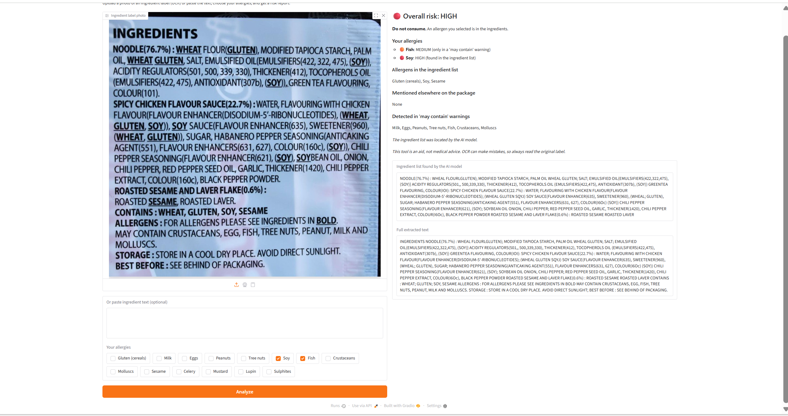
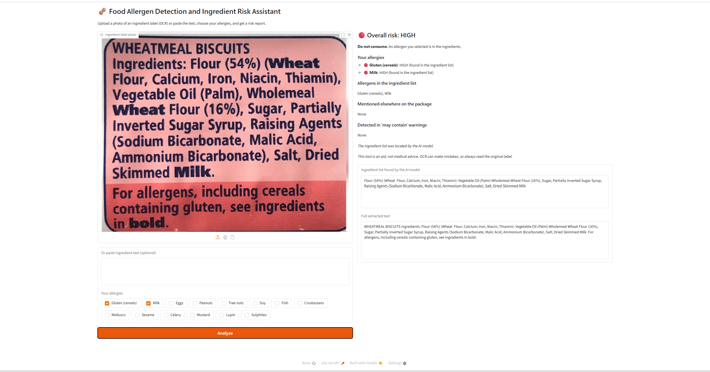
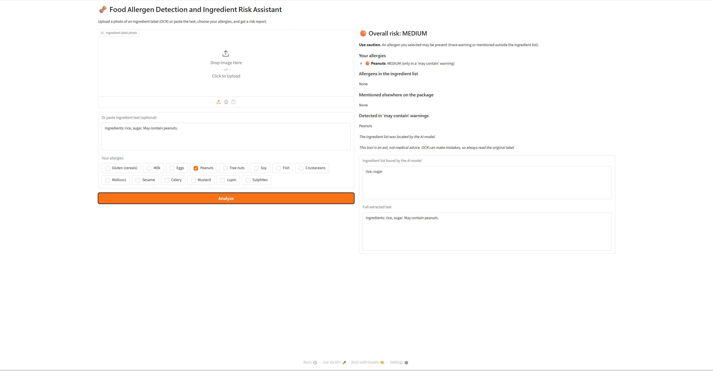

# AI-Powered Food Allergen Detection and Ingredient Risk Assistant Using NLP and OCR

**Student:** Rahimi Mohammad Mirwais
**Folder:** rah086
**Course:** Professional Training (YN3012170034)

## Overview
This application helps people with food allergies check a product quickly.
The user uploads a photo of a food label (or pastes the text), selects their
allergies, and receives a risk report that explains *why* each allergy is rated
high, medium or low.

## How It Works
1. **OCR:** EasyOCR reads the text from the label photo.
2. **Ingredient-list detection (fine-tuned model):** a multilingual DistilBERT
   token-classification model, trained for this project, finds the ingredient
   list inside the noisy OCR text of the whole package. The model is published at
   https://huggingface.co/mirwaisrahimi/ingredient-list-ner
3. **Allergen detection (NLP):** the text is tokenized and matched against a
   dictionary of 14 major allergen groups. Fuzzy matching and repair of common OCR
   confusions (`rn` read as `m`, `vv` as `w`) make it tolerant of OCR mistakes.
4. **Risk assessment:**
   - HIGH: the allergen is in the ingredient list
   - MEDIUM: the allergen is only in a "may contain" warning, or is mentioned
     elsewhere on the package (outside the ingredient list)
   - LOW: the allergen was not detected
5. **Interface:** a Gradio web app shows the report, the ingredient list and the
   extracted text.

If the model cannot be loaded, the app still works: it scans the whole text
instead of only the ingredient list.

## Screenshots
| Label 1 (noodles) | Label 2 (biscuits) | Pasted text |
|---|---|---|
|  |  |  |

## Project Structure
```
rah086/
├── app.py                 # Gradio web application
├── requirements.txt       # Python dependencies
├── src/
│   ├── ocr.py             # OCR module (EasyOCR)
│   ├── extractor.py       # Ingredient-list model (loads local copy or Hugging Face)
│   ├── detector.py        # Allergen detection (keywords + fuzzy matching)
│   ├── risk.py            # Risk assessment logic
│   ├── train_ner.py       # Fine-tuning script for the ingredient-list model
│   ├── upload_model.py    # Uploads the trained model to Hugging Face
│   └── evaluate.py        # Evaluation of the allergen detector
├── tests/                 # Unit tests
├── data/
│   ├── samples/           # Sample label images
│   └── raw/               # Datasets (NOT uploaded to GitHub)
└── docs/
    ├── ner_metrics.json   # Evaluation results of the trained model
    └── screenshots/       # Application screenshots
```

## Installation
Requires Python 3.10 or newer.

```bash
git clone https://github.com/rahimimohammadmirwais/PT22026.git
cd PT22026/rah086

python -m venv .venv
# Windows (PowerShell):
.\.venv\Scripts\Activate.ps1
# macOS / Linux:
# source .venv/bin/activate

pip install -r requirements.txt
```

On the first run, EasyOCR downloads its models (about 100 MB) and the app
downloads the ingredient-list model from Hugging Face (about 540 MB). Both are
stored outside the project and are not part of the repository.

## Usage
**Web app:**
```bash
python app.py
```
Open http://127.0.0.1:7860, upload a label image (or paste text), select your
allergies and click **Analyze**.

**Command line:**
```bash
python -m src.ocr data/samples/label1.jpg                  # OCR only
python -m src.extractor data/samples/label1.jpg            # OCR + ingredient list
python -m src.detector data/samples/label1.jpg             # OCR + allergens
python -m src.risk data/samples/label1.jpg "soy,fish"      # full risk report
python -m src.evaluate                                     # allergen detector evaluation
python -m unittest discover tests                          # unit tests
```

## Training the Ingredient-List Model
The model was fine-tuned from `distilbert-base-multilingual-cased` on the
Open Food Facts ingredient detection dataset (5,065 training and 556 test
documents with labelled ingredient lists, in several languages).

1. Put `ingredient_detection_dataset_train.jsonl.gz` and
   `ingredient_detection_dataset_test.jsonl.gz` into `data/raw/`.
2. Run:
```bash
python -m src.train_ner --epochs 2
```
Settings: 2 epochs, learning rate 5e-5, batch size 16, texts split into chunks of
100 words. Training took about 77 minutes on a CPU. The model is saved to
`models/ingredient-ner` (not uploaded to GitHub) and the scores to
`docs/ner_metrics.json`.

At prediction time the text is read in overlapping chunks, and each word keeps the
prediction from the chunk where it is farthest from the edges. This fixed a problem
found during testing: the ingredient list was cut off where a chunk ended.

## Evaluation
**Ingredient-list model** (556 held-out test documents, 74,691 words; the question
is "is this word part of the ingredient list?"):

| Metric    | Score  |
|-----------|--------|
| Precision | 0.9887 |
| Recall    | 0.9901 |
| F1 score  | 0.9894 |
| Accuracy  | 0.9919 |

A quick test with only 200 training documents and 1 epoch gave F1 = 0.911, so the
full training clearly helped.

**Allergen detector** (14 hand-written ingredient texts, 4 of them with simulated
OCR errors): precision 1.00, recall 1.00, F1 1.00. This set is small and was
written by the author, so it checks that the logic works but is not a benchmark.
An early version missed `sesarne` (`sesame` with `m` read as `rn`); this led to
the OCR-confusion repair described above.

## Limitations
- OCR accuracy drops on blurry, curved or very small text.
- The model scores are word-level and not exact span matches. The allergen
  detector was tested on a small hand-written set only.
- The allergen dictionary is English-only, so allergens named in other languages
  can be missed, even though the ingredient-list model is multilingual.
- Claims such as "gluten free" contain an allergen word and can be flagged as
  mentions outside the ingredient list (MEDIUM).
- This tool is an aid, **not medical advice**. Always read the original label.

## Acknowledgements
- Open Food Facts for the ingredient detection dataset (see Open Food Facts
  for its license terms): https://world.openfoodfacts.org
- `distilbert-base-multilingual-cased` (Hugging Face)
- EasyOCR: https://github.com/JaidedAI/EasyOCR
- Gradio: https://www.gradio.app
- Allergen list based on the major food allergens recognised in EU and Codex rules.
- Sample images are used for educational purposes only.