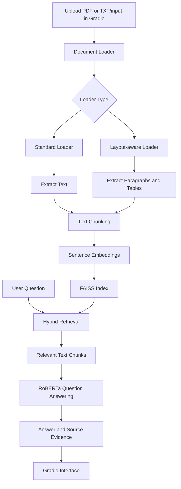

# DocuMind: Intelligent Document Question Answering System

DocuMind is a document question-answering application built with Python and AI models. It allows users to upload a PDF or TXT file and ask questions about its content.

Instead of searching through a long document manually, users can ask a question and receive an answer with its source page and supporting text.

The project uses document processing, text chunking, semantic embeddings, hybrid retrieval, and an extractive question-answering model.

## 1. Project Overview

The main goal of DocuMind is to make information in documents easier to find and understand.

The application follows these steps:

1. The user uploads a PDF or TXT file.
2. The application extracts text from the document.
3. The extracted text is divided into smaller chunks.
4. The chunks are converted into numerical embeddings.
5. The retriever finds relevant chunks using semantic and keyword matching.
6. The question-answering model reads the retrieved text and extracts an answer.
7. The application displays the answer, source page, and supporting evidence.

## 2. System Architecture

The following diagram shows the main workflow of the application.



## 3. Main Features

- **PDF and TXT Support:** Upload PDF and TXT documents.
- **Two Document Loaders:** Choose between Standard Loader and Layout-aware Loader.
- **Text Chunking:** Divide extracted text into smaller overlapping sections.
- **Semantic Search:** Find relevant content using sentence embeddings.
- **Hybrid Retrieval:** Combine semantic similarity and keyword matching.
- **Table-aware Retrieval:** Give additional attention to table content and handle selected table-based questions.
- **Extractive Question Answering:** Generate answers from the retrieved document content.
- **Source Evidence:** Display the source page and supporting text.
- **Retrieval Details:** View the retrieved chunks and their scores.
- **Configurable Settings:** Adjust chunk size, overlap, and retrieval depth.
- **Interactive Interface:** Use the application through a Gradio web interface.

## 4. Technologies and Models

| Component | Technology |
|---|---|
| Programming Language | Python |
| User Interface | Gradio |
| Document Processing | PyPDF and PyMuPDF |
| Text Embedding | Sentence Transformers |
| Embedding Model | `sentence-transformers/all-MiniLM-L6-v2` |
| Vector Search | FAISS |
| Question Answering | Hugging Face Transformers |
| QA Model | `deepset/roberta-base-squad2` |
| Data Processing | NumPy |
| Evaluation and Graphs | Matplotlib |

## 5. Retrieval Method

DocuMind uses a hybrid retrieval method. It combines semantic similarity with keyword matching to find useful document sections.

The retrieval score is calculated using:

```text
Hybrid Score = (0.55 × Semantic Score)
             + (0.45 × Keyword Score)
             + Table Bonus
```

A table bonus of `0.03` is applied when the relevant chunk contains table content.

**Semantic similarity** helps find text with a similar meaning, even when the exact words are different.

**Keyword matching** helps find text that contains important words from the user's question.

The application combines both scores to rank the retrieved chunks.

## 6. Question Answering

After retrieval, DocuMind uses the `deepset/roberta-base-squad2` model to extract an answer from the selected text.

The model receives:

- The user's question
- The retrieved document content

It then predicts an answer from that content.

The application also uses retrieval information when ranking answer candidates. This helps it select an answer that is supported by relevant document sections.

DocuMind is an extractive question-answering system. It does not train a new language model from scratch.

## 7. Project Structure

The following structure shows the main project files included in the repository.

```text
sia091/
├── app.py
├── src/
│   ├── answerer.py
│   ├── chunker.py
│   ├── embedder.py
│   ├── loader.py
│   ├── loader_layout.py
│   └── retriever.py
├── data/
│   ├── assignment_guidelines.pdf
│   ├── eiffel_answers.txt
│   ├── eiffel.pdf
│   └── sample.txt
├── eval/
│   ├── figures/
│   │   ├── controlled_best_configurations.png
│   │   ├── controlled_model_comparison.png
│   │   ├── controlled_ranking_strategies.png
│   │   ├── controlled_recall_vs_topk.png
│   │   ├── model_comparison.png
│   │   ├── ranking_rules.png
│   │   └── recall_vs_topk.png
│   ├── eval_eiffel.json
│   ├── eval_hard.json
│   ├── eval_set.json
│   ├── controlled_model_comparison.csv
│   ├── results.csv
│   └── results_distilbert.csv
├── evaluate.py
├── evaluate_layout.py
├── evaluate_strict.py
├── evaluate_models.py
├── plot_results.py
├── requirements.txt
├── .gitignore
├── .gitkeep
└── README.md
```

### Main Files and Their Responsibilities

| File | Purpose |
|---|---|
| `app.py` | Runs the Gradio application and connects the main components. |
| `src/loader.py` | Extracts text from PDF and TXT documents using the standard loader. |
| `src/loader_layout.py` | Extracts document content while considering paragraph and table layout. |
| `src/chunker.py` | Divides extracted content into overlapping chunks. |
| `src/embedder.py` | Converts text into numerical embeddings. |
| `src/retriever.py` | Finds and ranks relevant document chunks. |
| `src/answerer.py` | Extracts answers using the question-answering model. |
| `evaluate.py` | Runs the evaluation process. |
| `evaluate_strict.py` | Runs strict answer evaluation. |
| `evaluate_layout.py` | Evaluates the layout-aware document processing workflow. |
| `evaluate_models.py` | Runs 90 controlled experiments comparing DistilBERT and RoBERTa with different retrieval configurations. |
| `eval/controlled_model_comparison.csv` | Stores the results of the 90 controlled experiments. |
| `plot_results.py` | Creates graphs from evaluation results. |
| `eval/` | Contains evaluation question sets and recorded result files. |
| `requirements.txt` | Lists the Python dependencies. |

**Note:** The `data/` folder contains local test documents used during development. These files are not listed in the repository structure because they are not included in the tracked project files. Users can upload their own PDF or TXT documents through the application.

## 8. Installation

### Step 1: Clone the Repository

```bash
git clone -b rag-qa https://github.com/shakil57-max/PT22026.git
```

### Step 2: Open the Project Folder

```bash
cd PT22026/sia091
```

### Step 3: Create a Virtual Environment

```bash
python3 -m venv venv
```

### Step 4: Activate the Virtual Environment

For Linux or macOS:

```bash
source venv/bin/activate
```

### Step 5: Install the Dependencies

```bash
python -m pip install --upgrade pip
pip install -r requirements.txt
```

### Step 6: Run the Application

```bash
python app.py
```

After the application starts, open the local Gradio address shown in the terminal.

**Note:** The first run may need an internet connection to download the embedding and question-answering models from Hugging Face.

## 9. How to Use the Application

1. Open the DocuMind application in your browser.
2. Upload a PDF or TXT document.
3. Select a loader:
   - **Standard Loader:** Extracts text from the document.
   - **Layout-aware Loader:** Attempts to preserve paragraph and table information.
4. Set the chunk size and overlap.
5. Click **Process Document**.
6. Wait until document processing is complete.
7. Enter a question about the uploaded document.
8. Select the retrieval depth.
9. Click **Generate Answer**.
10. Read the answer and check the source evidence and retrieved chunks.

## 10. Evaluation

The project includes evaluation question sets and scripts to test document retrieval and question answering.

The evaluation files are stored in the `eval/` folder.

### Controlled Model Comparison

The project also includes 90 controlled experiments comparing two question-answering models: DistilBERT and RoBERTa. The experiments use 22 evaluation questions, three chunk sizes (40, 60, and 120), three retrieval depths (Top-1, Top-3, and Top-5), and five answer-ranking strategies. The results are stored in `eval/controlled_model_comparison.csv`.

The experiments compare retrieval performance and answer quality using Evidence Recall@K, Custom Permissive Accuracy, Exact Match, and Token F1. The `evaluate_models.py` script runs these experiments, while `plot_results.py` creates the comparison graphs.

The recorded retrieval results in `eval/results.csv` include experiments with different chunk sizes and retrieval depths.

### Recorded Retrieval Results

The following table shows the retrieval recall values recorded in `results.csv` for different configurations.

| Chunk Size | Top-K | Retrieval Recall |
|---:|---:|---:|
| 40 | 1 | 72.7% |
| 40 | 3 | 86.4% |
| 40 | 5 | 95.5% |
| 60 | 1 | 68.2% |
| 60 | 3 | 86.4% |
| 60 | 5 | 90.9% |
| 120 | 1 | 63.6% |
| 120 | 3 | 86.4% |
| 120 | 5 | 95.5% |

The highest recorded retrieval recall in these experiments is **95.5%**, achieved with chunk sizes of 40 and 120 when retrieving the top 5 chunks.

These values represent retrieval recall. They should not be interpreted as overall question-answering accuracy.

## 11. Current Limitations

- The standard PDF loader depends on extractable text. Scanned PDFs without a text layer are not supported by that loader.
- The quality of the answer depends on the quality of the extracted document text.
- Table extraction can vary depending on the PDF layout and formatting.
- The QA model extracts answers from retrieved text, so it may not answer questions that require information missing from the retrieved sections.
- The system is designed for document-based question answering, not general-purpose conversation.
- The embedding and QA models may need to be downloaded before the first use.

## 12. Future Improvements

Possible improvements include:

- Better support for scanned PDFs using OCR.
- More robust table extraction for different PDF layouts.
- Larger and more diverse evaluation datasets.
- Further improvements to retrieval ranking.
- More detailed evaluation of answer quality.
- Better handling of questions that require information from multiple document sections.

## 13. Author

Developed as a university course project.

**Project Name:** DocuMind  
**Repository:** [PT22026](https://github.com/shakil57-max/PT22026)  
**Project Folder:** `sia091`  
**Branch:** `rag-qa`

##14. Project Structure

```text
sia091/
├── app.py
├── src/
│   ├── answerer.py
│   ├── chunker.py
│   ├── embedder.py
│   ├── loader.py
│   ├── loader_layout.py
│   └── retriever.py
├── data/
│   ├── assignment_guidelines.pdf
│   ├── eiffel_answers.txt
│   ├── eiffel.pdf
│   └── sample.txt
├── eval/
│   ├── figures/
│   │   ├── controlled_best_configurations.png
│   │   ├── controlled_model_comparison.png
│   │   ├── controlled_ranking_strategies.png
│   │   ├── controlled_recall_vs_topk.png
│   │   ├── model_comparison.png
│   │   ├── ranking_rules.png
│   │   └── recall_vs_topk.png
│   ├── eval_eiffel.json
│   ├── eval_hard.json
│   ├── eval_set.json
│   ├── controlled_model_comparison.csv
│   ├── results.csv
│   └── results_distilbert.csv
├── evaluate.py
├── evaluate_layout.py
├── evaluate_strict.py
├── evaluate_models.py
├── plot_results.py
├── requirements.txt
├── .gitignore
├── .gitkeep
└── README.md
